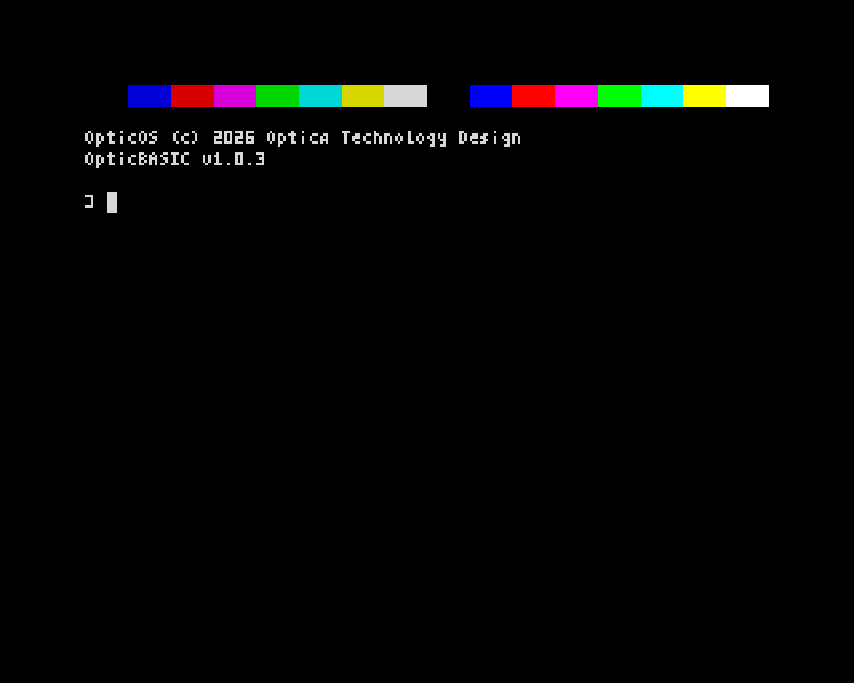
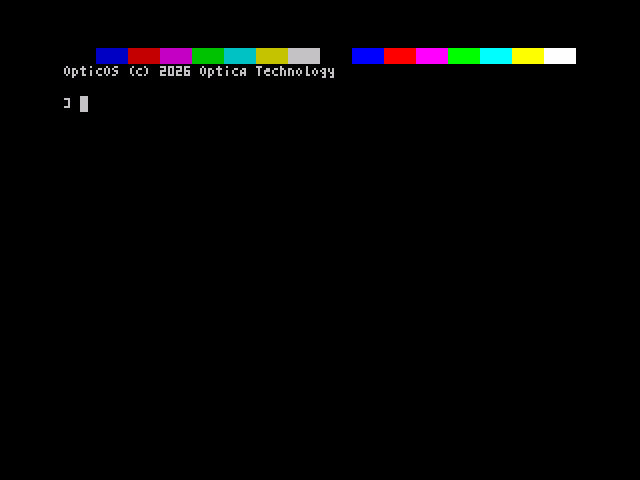
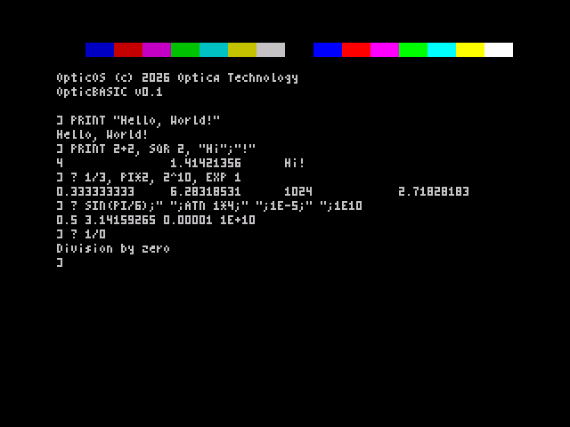
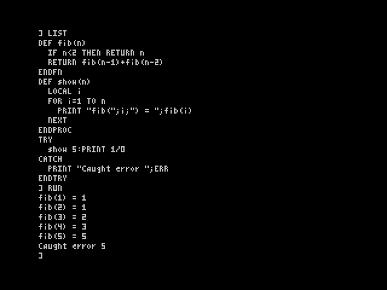
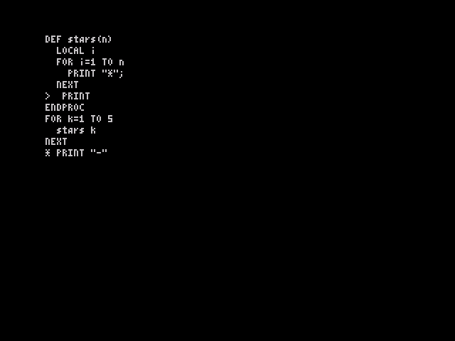
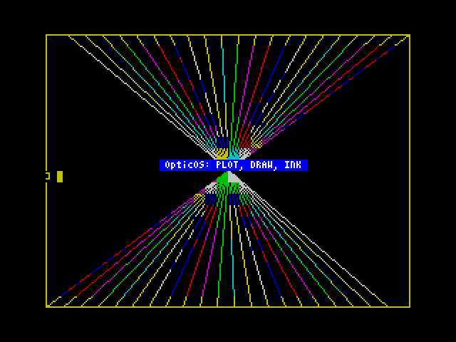

# OpticOS

[](https://github.com/brixham99/OpticOS/releases) [](https://github.com/brixham99/OpticOS/releases/latest)



*A clean-room replacement 16K ROM for the 48K ZX Spectrum.*

**OpticOS** is a new operating environment and BASIC, **OpticBASIC**, for the Sinclair ZX Spectrum. It boots from a 16,384-byte ROM, just as the original did, but the language has no line numbers: you write named procedures and functions with a Sinclair-style line editor, on a 64-column display that uses a condensed 4-pixel font.

The boot message reads:

```
OpticOS (c) 2026 Optica Technology Design
```

**Status: Phases 0–5 complete.** The planned feature list (after the cuts in spec §12) is built and fits the 16K ROM with 116 bytes to spare (v1.0.3; 116 is now the accepted margin). The ROM boots, loads ordinary game tapes, runs structured OpticBASIC programs, and has a Sinclair-style line editor. The **[user manual (PDF)](docs/manual/OpticOS_User_Manual.pdf)** covers the whole system, with worked examples ([source](docs/manual)). The **[example tape](examples)** (`.tap` and `.tzx`) holds the manual's examples and three more, verified in Fuse. OpticOS has been run on real hardware, a Cobra (see [Running OpticOS](#running-opticos)), but not yet on an original Sinclair Spectrum. The design is in the [specification (PDF)](docs/spec.pdf) ([Markdown](docs/spec.md)); §4.8 lists what is built.

| Phase | What it delivered | Report |
|---|---|---|
| 0–1 | Test rig, boot, 64-column screen, keyboard, tape, compatibility entry points, legacy loader (`LOAD ""` loads real game tapes, traps off) | [docs/phase1](docs/phase1/README.md) |
| 2 | Clean-room floating point: + − × ÷, SQR, SIN/COS/TAN/ATN, EXP/LN, STR$/VAL, RND | [docs/phase2](docs/phase2/README.md), [maths API](docs/maths.md) |
| 3 | Tokenised interpreter with no line numbers | [docs/phase3](docs/phase3/README.md) |
| 4 | ZX-style line editor: current-line marker, EDIT, AUTO | [docs/phase4](docs/phase4/README.md) |
| 5a | Size pass (ASN/ACS dropped), INPUT, DATA/READ/RESTORE, SAVE/LOAD/VERIFY with CODE | [docs/phase5](docs/phase5/README.md) |
| 5b | Squeezes, PLOT/DRAW, FLASH/BRIGHT/INVERSE/OVER and colours in PRINT, BEEP, INSTR/STRING$/HEX$/UPPER$/ERR$, IN/OUT/USR/CALL/DPEEK/DPOKE, SWAP, start-up chime | [docs/phase5](docs/phase5/README.md#phase-5b-nathans-cuts-the-squeezes-graphics-and-functions) |
| 5c | Last cuts and squeezes, CASE, EXIT, `ERROR n, msg$`, CLEAR, FREE, KEY, RUN/RESTORE/SAVE … AUTO with a PROC name | [docs/phase5](docs/phase5/README.md#phase-5c-the-last-features) |

## Screenshots

All are from real [Fuse](https://fuse-emulator.sourceforge.net/) with traps and loader acceleration off.

| Boot | Direct mode |
|---|---|
|  |  |
| **A structured program, LIST and RUN** | **The line editor: marker and EDIT** |
|  |  |
| **Graphics: PLOT, DRAW, colours** | **INPUT and DATA / READ** |
|  |  |

## What works today

- A drop-in 16K ROM for the 48K Spectrum. It runs on emulators such as Fuse and on The Spectrum (2024), and a user has confirmed it on a Cobra, a real machine. It has not yet been tried on an original Sinclair Spectrum.
- **64-column text** in an original 4×8 font, with colours (`INK PAPER FLASH BRIGHT INVERSE OVER`, also inside PRINT), scrolling and `PRINT AT`/`TAB`.
- **Graphics and sound:** `PLOT`, `DRAW dx,dy`, `DRAW TO x,y` on the full 256×192 screen, and `BEEP duration, pitch`. At a cold start it plays the BBC Micro's two power-on tones in reverse, at half their length: 523 Hz for 0.15 s, then 122 Hz for 0.45 s (spec §6.7).
- **OpticBASIC with no line numbers:**
  - named procedures and functions with parameters, dynamic `LOCAL` and recursion; procedures are called by bare name
  - block `IF` / `ELSEIF` / `ELSE` / `ENDIF`, `CASE` / `WHEN` / `OTHERWISE` / `ENDCASE`, `WHILE` / `WEND`, `REPEAT` / `UNTIL`, `FOR` / `NEXT`, `EXIT WHILE` / `REPEAT` / `FOR`, and `TRY` / `CATCH` / `ENDTRY` with `ERROR n [, msg$]`
  - floats, 16-bit integers (`a%`), strings up to 255 characters with a garbage-collected heap, and arrays of up to 3 dimensions
  - `INPUT`, `DATA` / `READ` / `RESTORE [procname]`, `CLEAR [ramtop]`, `FREE`, and `SAVE` / `LOAD` / `VERIFY` of programs and `CODE` on a standard tape signal; `SAVE "x" AUTO procname` starts a program when it loads, and `RUN procname` runs one PROC
  - the usual maths and string functions plus `INSTR`, `STRING$`, `HEX$`, `UPPER$`, `ERR$`, `INKEY$`, `KEY(k$)` (several keys at once, for games), `FRAMES`, `MAX`, `MIN`, hex (`&FF`) and binary (`%1010`) literals
  - machine access: `PEEK`/`POKE`, `DPEEK`/`DPOKE`, `IN`/`OUT` (`IN 31` reads a Kempston joystick), `USR`, `CALL`, `BORDER`, and `SWAP a, b`
  - an indenting `LIST`: the indentation is not stored but recomputed from the block structure; it pauses after each screenful with `cont?` (Y for more)
- **Keywords are typed letter by letter** and tokenised on entry. The keyword legends on the keys are ignored.
- **Tape compatibility.** The standard ROM tape format and entry points (`LD-BYTES`, `SA-BYTES`, `BEEPER`, the RST vectors and others) are kept, so `LOAD ""` loads ordinary games, including ones with a BASIC loader, through a small legacy shim.
- **Clean-room implementation.** OpticOS contains no Sinclair, Amstrad or Tasword code or artwork. A build check confirms that no run of 12 or more bytes is shared with the original ROM.

Not in v1.0.x: UDGs are planned and `MODE 32` is under consideration (see [Planned / under consideration](#planned--under-consideration)). Dropped by decision (spec §12): `CIRCLE`, `LABEL`/`GOTO`, `SOUND`, `ASN`/`ACS`, `SCREEN$()`, `ATTR`, `POINT`, `FIND`, `CONT`, array parameters by reference, `CALL` register arguments, `CAT`, the OpticBASIC `SCREEN$` tape forms (legacy loaders keep `LOAD "" SCREEN$`) and `JOY`.

## A short example

```
] AUTO
+ DEF fib(n)
+ IF n<2 THEN RETURN n
+ RETURN fib(n-1)+fib(n-2)
+ ENDFN
+ FOR i=1 TO 10
+ PRINT fib(i);" ";
+ NEXT
+
] RUN
1 1 2 3 5 8 13 21 34 55
```

`AUTO` starts line entry, and the empty line at the end stops it. Anything typed at the `]` prompt runs at once.

## The line editor

There is no full-screen editor. Editing follows the ZX BASIC pattern: the program has a **current line**, shown with `>` in a LIST, and you edit it in place.

| Key | Action |
|---|---|
| `AUTO`, then ENTER on an empty line | Start, then stop, entering lines. Each new line goes in after the current one. |
| `LIST` | List the program with `>` on the current line, a screenful at a time: at `cont?` press Y for more, any other key to stop with the marker on the screenful's first line |
| CAPS+7 / CAPS+6 | Move the marker up / down and relist around it |
| CAPS+1 (EDIT) | Copy the current line into the input line (prompt `*`), then ENTER to replace it |
| EDIT, EDIT, ENTER | Delete the current line |
| CAPS+5 / CAPS+8 | Cursor left / right in the input line (up to 126 characters, two rows) |
| CAPS+0 | Delete the character to the left of the cursor |
| SYMBOL SHIFT + key | The red symbol on the key (`"` `=` `+` `<` `;` …) |
| CAPS+SPACE | BREAK |

When a program stops with an error, the failing line becomes the current line, so EDIT brings it straight up.

## Building and running

```
make                # or ./build.sh: assembles build/opticos.rom (16,384 bytes) with pasmo and checks the layout
make check          # headless rig tests (add REF=/path/to/48.rom for the reference comparisons)
fuse-sdl --machine 48 --rom-48 build/opticos.rom                     # .tap files load at once (tape traps on)
fuse-sdl --machine 48 --rom-48 build/opticos.rom --no-traps --no-detect-loader --no-accelerate-loader
```

Since v1.0.1 the ROM keeps the tape layout that emulator traps expect, so Fuse's tape traps work and `.tap` files load at once; v1.0 itself needs `--no-traps`. The second line turns the traps and loader acceleration off, so tapes load from the real signal in real time, as on a Spectrum; the tests run both ways. `build/` is gitignored. You need `pasmo` 0.5.3, `gcc` and Python 3 with Pillow.

## Running OpticOS

OpticOS is a standard 16K ROM image, so anything that can run a 48K Spectrum with a different ROM can run it. Besides Fuse (above), these ways are known:

### Real hardware: the Cobra

Vicențiu Iordăchescu runs OpticOS on a [Cobra](https://cobrasov.org/), a real machine. He flashed `opticos.rom` into its EEPROM unchanged; the Cobra can also load a ROM from tape. This is the first confirmed run on real hardware. OpticOS has still not been tried on an original Sinclair Spectrum.

### The Spectrum (2024)

A four-page [QuickStart booklet](docs/quickstart) (one A4 sheet, printed double-sided and folded to A5) covers this for people using an OpticOS USB stick. On The Spectrum from Retro Games, use the `.tzx` tapes: its instant `.tap` loading only works with ROMs it recognises, and pressing ENTER in Media select to auto-load does not work with OpticOS. In Media select pick the `.tzx` and press **M** (not ENTER), close the menu, type `LOAD ""`, then hold HOME and press Down to open the tape controller and press play. On Fuse and other emulators `.tap` files load as usual. See the manual, "Loading on The Spectrum (2024)".

### Limoniter

[Limoniter](https://limoniter.com), the text and hex editor for older computers by Jolyon Ralph, supports OpticBASIC directly. Choose **File > New**, pick **OpticBasic**, write your program and press **F9** to test it in Limoniter's built-in ZX Spectrum emulator. Version 0.9 is due to update OpticOS automatically.

### OpticOS/RAM

[OpticOS/RAM](https://github.com/tuklusan/OpticOS/releases), by Supratim Sanyal, is a fork that turns OpticOS into a program that loads into RAM, so no ROM swap is needed. Its release page describes it as a RAM-resident edition for a standard 48K Spectrum: boot with the normal Sinclair ROM, type `LOAD ""` and play its `.tzx`, whose BASIC loader loads and starts it. It does not load ordinary Sinclair BASIC or game tapes, and you reset the machine to return to Sinclair BASIC. See its page for details and its own testing status.

### ClockworkPi PicoCalc

James Andrews has OpticOS running natively on a [ClockworkPi](https://www.clockworkpi.com/) PicoCalc, the handheld with a keyboard. He forked OpticOS and built native firmware for it. It boots to the OpticBASIC prompt. The firmware isn't public yet.

### goSpectrum

[goSpectrum](https://github.com/andrewsjg/goSpectrum), also by James Andrews, is a ZX Spectrum emulator written in Go. It runs custom 16K ROMs on its 48K hardware: pick the **Other** machine card and choose `opticos.rom`, or pass `--rom opticos.rom` on the command line. The file dialog is macOS only.

### Community

Questions, reports and ideas are welcome in the [Spectrum Computing forum thread](https://spectrumcomputing.co.uk/forums/viewtopic.php?f=3&t=16427).

## Planned / under consideration

- **UDGs** (user-defined graphics) are planned. They were dropped earlier for lack of space (spec §12), so they need some space optimisations first.
- **A 32-column mode** or **a 128K edition** is being considered.

There are no dates for any of these.

## ROM byte usage (Phase 5 complete)

16,268 of 16,384 bytes are placed, leaving **116 free** in v1.0.3. 116 bytes is now the accepted margin, agreed by Nathan in place of the earlier rule of at least 221 spare (256 until v1.0.1; v1.0.2 had 227 free). v1.0.3's new tape stripe colours cost 10 bytes and the LIST `cont?` pause 101; the shorter chime cost nothing. By module, as `tools/check_layout.py` reports them:

| Part | Bytes |
|---|---:|
| Interpreter: run loop, statements, prepass, PROC/FN, TRY | 2,394 |
| Tokeniser, keyword table, LIST | 1,848 |
| Float core (+ - * /, normalise, compare, conversions, small-int ops) | 1,422 |
| Expression evaluator and functions | 1,329 |
| Variables, arrays, string heap + GC, value and control stacks | 1,290 |
| Transcendentals, byte-code runner, coefficient tables | 1,148 |
| Legacy loader shim (interpreter, expressions, PRINT) | 845 |
| Number <-> string (STR$/PRINT formatting, VAL) | 709 |
| 64-column print, control codes, colours, scroll, CLS, RST 16 | 584 |
| Errors: RST 8 handler and messages | 491 |
| String and machine functions: INSTR STRING$ HEX$ UPPER$ ERR$ IN USR DPEEK KEY FREE | 465 |
| Direct mode and console: input line with insert/delete/cursor | 422 |
| Tape commands: SAVE / LOAD / VERIFY, CODE, headers, name match | 428 |
| 4-pixel font | 384 |
| Interrupt routine, keyboard scan, key tables | 355 |
| Tape low level: SA-BYTES, LD-BYTES, edges, tape_ret | 317 |
| CASE, EXIT, ERROR n [,msg$], CLEAR [n], PROC-name lookup | 343 |
| Restarts, NMI, reset, RAM test, sysvars, channels | 300 |
| Line editor: marker, LIST around it, cursor up/down, EDIT | 269 |
| Graphics: PLOT, DRAW, DRAW TO | 236 |
| BEEP, OUT, DPOKE, CALL, SWAP; start-up chime | 226 |
| INPUT, DATA / READ / RESTORE | 183 |
| Sound: BEEPER | 82 |
| Fixed-address stubs (CHAN-OPEN, PR-STRING, PIXEL-ADD, $096F) | 78 |
| Boot banner + version text, calls | 70 |
| Number output for the legacy shim and console (pr_dec, pr_hex) | 50 |

The free bytes are spread over about eleven gaps between the ROM's fixed addresses, the largest 27 bytes.

## The boot screen

The mock-up above matches the ROM's real boot screen pixel for pixel (the rig checks this). It is a faithful ZX Spectrum frame: 256×192 pixels of bitmap, with a 32-pixel black border, giving a 320×256 image (and a 3× nearest-neighbour upscale here so the text is readable). Paper is black, ink is white, bright is off.

Row 0 is a colour bar made from attribute cells only: 16 swatches, each two cells wide, showing black, blue, red, magenta, green, cyan, yellow and white, first normal and then BRIGHT. Row 1 is blank. Row 2 holds the banner, `OpticOS (c) 2026 Optica Technology Design`, and row 3 the BASIC's name and version, `OpticBASIC v1.0.3`. Row 4 is blank. Row 5 shows the OpticOS prompt `] ` with the cursor block (character 127) at column 2. `]` is the direct-mode prompt everywhere. Everything below the bar is white on black. The font has no copyright glyph — a © is illegible at 3 pixels wide — so the banner uses ASCII `(c)`, as the specification requires.

The native 1× frame is [`assets/opticos_boot.png`](assets/opticos_boot.png).

## The font

The default character set is a 96-glyph 4×8 font (codes 32–127), with a 3-pixel-wide ink grid and a fourth blank column so neighbours have a gap. Two glyphs are packed per byte, which comes to 384 bytes, destined for `$3E80–$3FFF` in the ROM. Code 127 is the editor cursor and wrap mark.

The artwork is original. The idea of a 64-column Spectrum display comes from Tasword Two (Tasman Software, 1983); the bitmaps do not.

| File | What it is |
|---|---|
| [`font/font4.txt`](font/font4.txt) | ASCII-art source for every glyph |
| [`font/font4x8.py`](font/font4x8.py) | The same glyphs, plus the packed 384-byte image |
| [`font/font4x8.bin`](font/font4x8.bin) | Packed font, ready to assemble at `$3E80` |
| [`font/make_font.py`](font/make_font.py) | Regenerates the font files and the boot mock-up |
| [`assets/font_sheet.png`](assets/font_sheet.png) | A labelled sheet of all 96 glyphs |

## What is not in this repository

A Sinclair `48.rom` image is **not** included, and never will be. If a later test rig needs one as a behavioural reference, you must supply your own and keep it out of the tree (`roms/` and `*.rom` are gitignored).

## Licence

Code is under the MIT licence. Artwork and text are under [CC BY 4.0](https://creativecommons.org/licenses/by/4.0/). See [LICENSE](LICENSE).

Copyright (c) 2026 Optica Technology Design.
