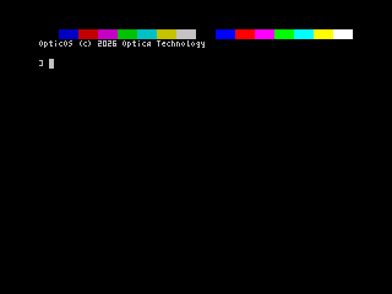
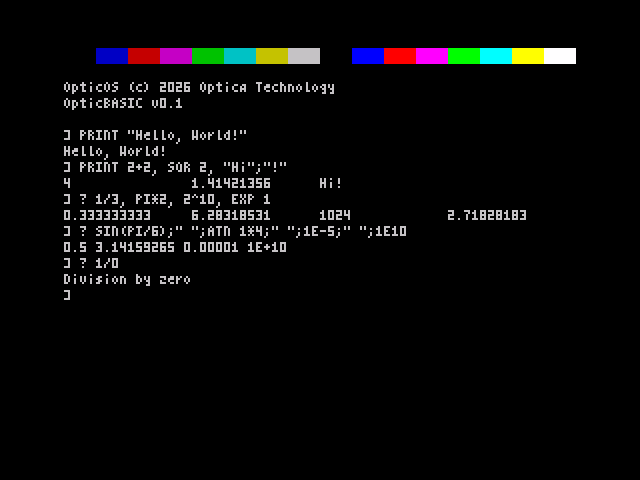
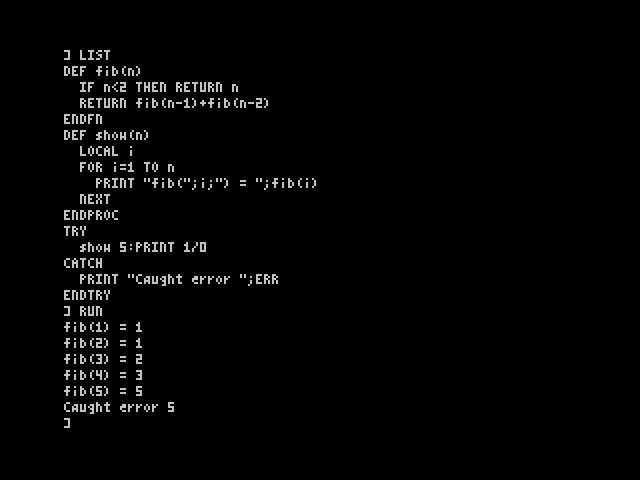
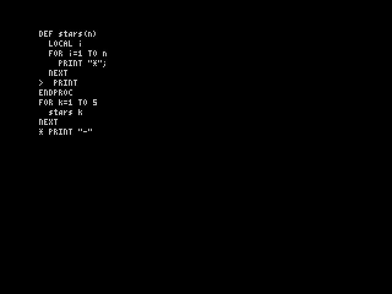

# OpticOS


*A clean-room replacement 16K ROM for the 48K ZX Spectrum.*

**OpticOS** is a new operating environment and BASIC, **OpticBASIC**, for the Sinclair ZX Spectrum. It boots from a 16,384-byte ROM, just as the original did, but the language has no line numbers: you write named procedures and functions with a Sinclair-style line editor, on a 64-column display that uses a condensed 4-pixel font.

The boot message reads:

```
OpticOS (c) 2026 Optica Technology
```

**Status: Phases 0–4 complete; Phase 5 under way.** The ROM boots, loads ordinary game tapes, runs structured OpticBASIC programs, and has a Sinclair-style line editor. Phase 5a added `INPUT`, `DATA`/`READ`/`RESTORE` and `SAVE`/`LOAD`/`VERIFY`. The design is in the [specification (PDF)](docs/spec.pdf) ([Markdown](docs/spec.md)); §4.8 lists what is built and what is not yet.

| Phase | What it delivered | Report |
|---|---|---|
| 0–1 | Test rig, boot, 64-column screen, keyboard, tape, compatibility entry points, legacy loader (`LOAD ""` loads real game tapes, traps off) | [docs/phase1](docs/phase1/README.md) |
| 2 | Clean-room floating point: + − × ÷, SQR, SIN/COS/TAN/ATN, EXP/LN, STR$/VAL, RND | [docs/phase2](docs/phase2/README.md), [maths API](docs/maths.md) |
| 3 | Tokenised interpreter with no line numbers | [docs/phase3](docs/phase3/README.md) |
| 4 | ZX-style line editor: current-line marker, EDIT, AUTO | [docs/phase4](docs/phase4/README.md) |
| 5a | Size pass (ASN/ACS dropped), INPUT, DATA/READ/RESTORE, SAVE/LOAD/VERIFY with CODE | [docs/phase5](docs/phase5/README.md) |

## Screenshots

All are from real [Fuse](https://fuse-emulator.sourceforge.net/) with traps and loader acceleration off.

| Boot | Direct mode |
|---|---|
|  |  |
| **A structured program, LIST and RUN** | **The line editor: marker and EDIT** |
|  |  |

## What works today

- A drop-in 16K ROM for the 48K Spectrum, on emulators such as Fuse (not yet tried on real hardware).
- **64-column text** in an original 4×8 font, with colours, scrolling and `PRINT AT`/`TAB`.
- **OpticBASIC with no line numbers:**
  - named procedures and functions with parameters, dynamic `LOCAL` and recursion; procedures are called by bare name
  - block `IF` / `ELSEIF` / `ELSE` / `ENDIF`, `WHILE` / `WEND`, `REPEAT` / `UNTIL`, `FOR` / `NEXT`, and `TRY` / `CATCH` / `ENDTRY` error handling
  - floats, 16-bit integers (`a%`), strings up to 255 characters with a garbage-collected heap, and arrays of up to 3 dimensions
  - `INPUT`, `DATA` / `READ` / `RESTORE`, and `SAVE` / `LOAD` / `VERIFY` of programs and `CODE` on a standard tape signal
  - the usual maths and string functions, plus `INKEY$`, `FRAMES`, `MAX`, `MIN`, hex (`&FF`) and binary (`%1010`) literals
  - an indenting `LIST`: the indentation is not stored but recomputed from the block structure
- **Keywords are typed letter by letter** and tokenised on entry. The keyword legends on the keys are ignored.
- **Tape compatibility.** The standard ROM tape format and entry points (`LD-BYTES`, `SA-BYTES`, `BEEPER`, the RST vectors and others) are kept, so `LOAD ""` loads ordinary games, including ones with a BASIC loader, through a small legacy shim.
- **Clean-room implementation.** OpticOS contains no Sinclair, Amstrad or Tasword code or artwork. A build check confirms that no run of 12 or more bytes is shared with the original ROM.

Still to come (Phase 5): graphics (`PLOT`, `DRAW`, `CIRCLE`), `BEEP`, `CASE`, `EXIT`, `SWAP`, `INSTR`, `STRING$`, `HEX$`, `UPPER$`, `ERR$`, and `MODE 32`/UDGs from BASIC.

## A short example

```
] AUTO
+ DEF fib(n)
+ IF n<2 THEN RETURN n
+ RETURN fib(n-1)+fib(n-2)
+ ENDFN
+ FOR i=1 TO 10
+ PRINT fib(i);" ";
+ NEXT
+
] RUN
1 1 2 3 5 8 13 21 34 55
```

`AUTO` starts line entry, and the empty line at the end stops it. Anything typed at the `]` prompt runs at once.

## The line editor

There is no full-screen editor. Editing follows the ZX BASIC pattern: the program has a **current line**, shown with `>` in a LIST, and you edit it in place.

| Key | Action |
|---|---|
| `AUTO`, then ENTER on an empty line | Start, then stop, entering lines. Each new line goes in after the current one. |
| `LIST` | List the program with `>` on the current line |
| CAPS+7 / CAPS+6 | Move the marker up / down and relist around it |
| CAPS+1 (EDIT) | Copy the current line into the input line (prompt `*`), then ENTER to replace it |
| EDIT, EDIT, ENTER | Delete the current line |
| CAPS+5 / CAPS+8 | Cursor left / right in the input line (up to 126 characters, two rows) |
| CAPS+0 | Delete the character to the left of the cursor |
| SYMBOL SHIFT + key | The red symbol on the key (`"` `=` `+` `<` `;` …) |
| CAPS+SPACE | BREAK |

When a program stops with an error, the failing line becomes the current line, so EDIT brings it straight up.

## Building and running

```
make                # or ./build.sh: assembles build/opticos.rom (16,384 bytes) with pasmo and checks the layout
make check          # headless rig tests (add REF=/path/to/48.rom for the reference comparisons)
fuse-sdl --machine 48 --rom-48 build/opticos.rom --no-traps --no-detect-loader --no-accelerate-loader
```

Fuse needs `--no-traps` so that its tape traps don't bypass the OpticOS tape routines. The two loader flags make tapes load in real time, which is how the tests run. `build/` is gitignored. You need `pasmo` 0.5.3, `gcc` and Python 3 with Pillow.

## ROM byte usage (after Phase 5a)

14,899 of 16,384 bytes are placed, leaving **1,485 free**. The largest parts:

| Part | Bytes |
|---|---:|
| Interpreter: run loop, statements, prepass, PROC/FN, TRY | 2,417 |
| Floating-point core | 1,424 |
| Tokeniser, keyword table, LIST | 1,611 |
| Expression evaluator and functions | 1,362 |
| Transcendental functions | 1,243 |
| Variables, arrays, string heap and GC | 1,297 |
| Legacy loader shim | 845 |
| Number ↔ text conversion | 738 |
| 64-column printing and the screen | 578 |
| Errors and messages | 502 |
| Input line and line editor | 684 |
| INPUT, DATA / READ / RESTORE | 182 |
| Tape commands: SAVE / LOAD / VERIFY | 404 |
| Font (96 glyphs at 4×8) | 384 |
| Everything else (restarts, keyboard, tape signal, beeper, fixed-address stubs) | 1,228 |

On the [spec's budget](docs/spec.md#82-budget) the full planned feature list is still about 1,180 bytes too big for the ROM once a 256-byte safety margin is kept. [docs/phase5](docs/phase5/README.md) lists the options for closing the gap.

## The boot screen

The mock-up above matches the ROM's real boot screen pixel for pixel (the rig checks this). It is a faithful ZX Spectrum frame: 256×192 pixels of bitmap, with a 32-pixel black border, giving a 320×256 image (and a 3× nearest-neighbour upscale here so the text is readable). Paper is black, ink is white, bright is off.

Row 0 is a colour bar made from attribute cells only: 16 swatches, each two cells wide, showing black, blue, red, magenta, green, cyan, yellow and white, first normal and then BRIGHT. Row 1 is blank. Row 2 holds the banner, `OpticOS (c) 2026 Optica Technology`, and row 3 the BASIC's name and version, `OpticBASIC v0.1`. Row 4 is blank. Row 5 shows the OpticOS prompt `] ` with the cursor block (character 127) at column 2. `]` is the direct-mode prompt everywhere. Everything below the bar is white on black. The font has no copyright glyph — a © is illegible at 3 pixels wide — so the banner uses ASCII `(c)`, as the specification requires.

The native 1× frame is [`assets/opticos_boot.png`](assets/opticos_boot.png).

## The font

The default character set is a 96-glyph 4×8 font (codes 32–127), with a 3-pixel-wide ink grid and a fourth blank column so neighbours have a gap. Two glyphs are packed per byte, which comes to 384 bytes, destined for `$3E80–$3FFF` in the ROM. Code 127 is the editor cursor and wrap mark.

The artwork is original. The idea of a 64-column Spectrum display comes from Tasword Two (Tasman Software, 1983); the bitmaps do not.

| File | What it is |
|---|---|
| [`font/font4.txt`](font/font4.txt) | ASCII-art source for every glyph |
| [`font/font4x8.py`](font/font4x8.py) | The same glyphs, plus the packed 384-byte image |
| [`font/font4x8.bin`](font/font4x8.bin) | Packed font, ready to assemble at `$3E80` |
| [`font/make_font.py`](font/make_font.py) | Regenerates the font files and the boot mock-up |
| [`assets/font_sheet.png`](assets/font_sheet.png) | A labelled sheet of all 96 glyphs |

## What is not in this repository

A Sinclair `48.rom` image is **not** included, and never will be. If a later test rig needs one as a behavioural reference, you must supply your own and keep it out of the tree (`roms/` and `*.rom` are gitignored).

## Licence

Code is under the MIT licence. Artwork and text are under [CC BY 4.0](https://creativecommons.org/licenses/by/4.0/). See [LICENSE](LICENSE).

Copyright (c) 2026 Optica Technology.
