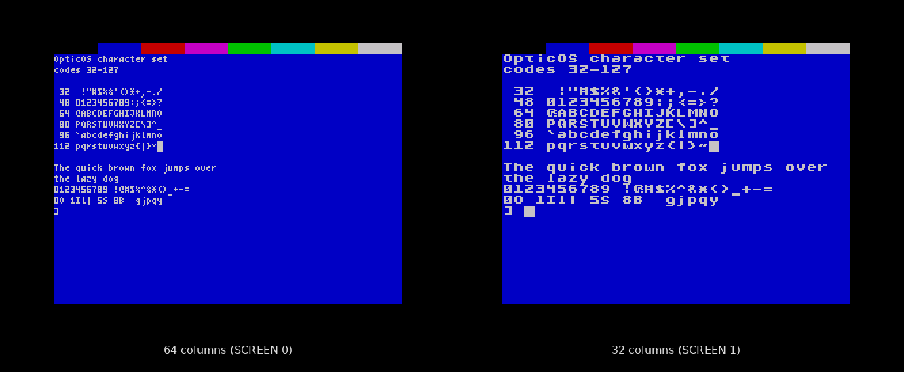
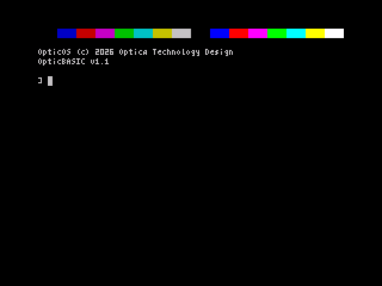
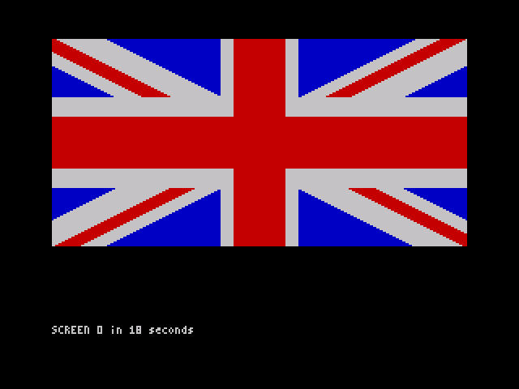
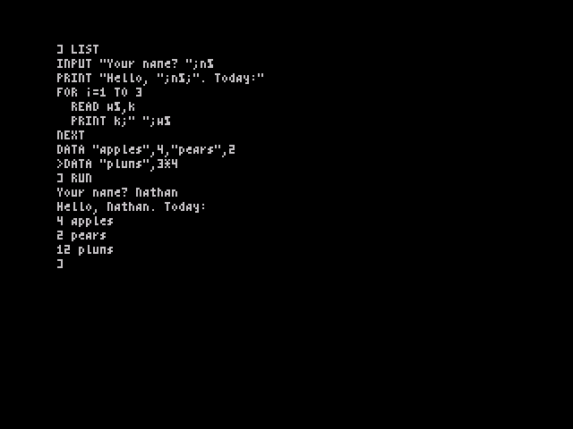
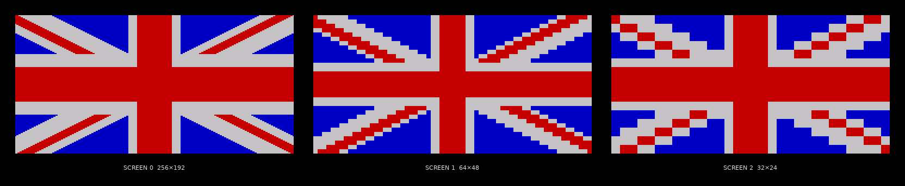
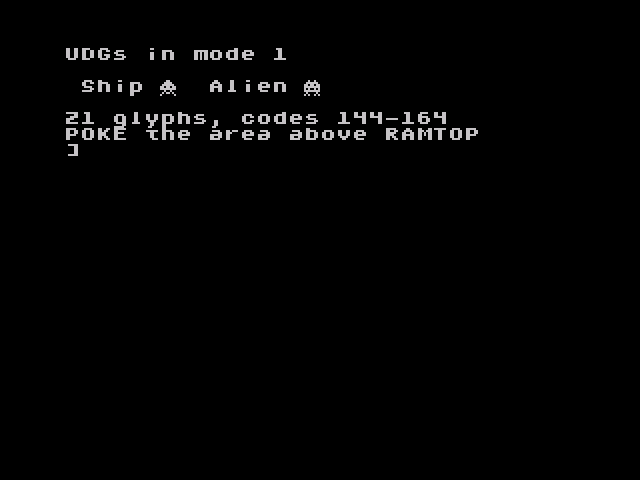
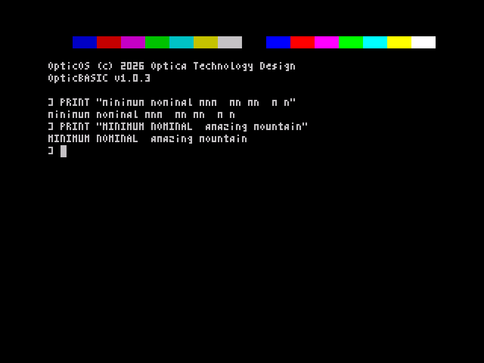

# OpticOS

[](https://github.com/brixham99/OpticOS/releases) [](https://github.com/brixham99/OpticOS/releases/latest)


*A clean-room operating environment and BASIC for the ZX Spectrum, in 48K and 128K editions.*

**OpticOS** is a new operating environment and BASIC, **OpticBASIC**, for the Sinclair ZX Spectrum. It comes in two editions that share the same 16,384-byte main ROM:

- The **48K edition** is a drop-in replacement for the Sinclair 16K ROM. OpticBASIC has no line numbers: you write named procedures and functions with a Sinclair-style line editor, on a 64-column display that uses a condensed 4-pixel font.
- The **128K edition** uses that same main ROM in slot 0, plus an **extension ROM in slot 1**. It adds `SCREEN 0`–`3` (including 32-column hi-res text with a new 8×8 font), chunky and attribute graphics, `PLOT`/`DRAW`/`BOX`/`CIRCLE`, `SCREEN FLIP`, user-defined graphics and G-mode in mode 1, and SAY/OpticVoice.

The boot message reads:

```
OpticOS (c) 2026 Optica Technology Design
```

**Status: v1.1.** Phases 0–5 of the 48K ROM are complete, and the 128K edition's screen, graphics, UDG and SAY features ship in the same release. The ROM boots, loads ordinary game tapes, runs structured OpticBASIC programs, and has a Sinclair-style line editor. The **[user manual (PDF)](docs/manual/OpticOS_User_Manual.pdf)** covers the 48K system, with worked examples ([source](docs/manual)). The **[example tape](examples)** (`.tap` and `.tzx`) holds the manual's examples and three more, verified in Fuse; the 128K demos `flags128`, `circles128` and `udg128` are in the same folder. OpticOS has been run on real hardware, a Cobra (see [Running OpticOS](#running-opticos)), but not yet on an original Sinclair Spectrum. The design is in the [specification (PDF)](docs/spec.pdf) ([Markdown](docs/spec.md)); §4.8 lists what is built in the main ROM. The 128K screen model is described in [docs/opticbasic128-screen.md](docs/opticbasic128-screen.md).

| Phase | What it delivered | Report |
|---|---|---|
| 0–1 | Test rig, boot, 64-column screen, keyboard, tape, compatibility entry points, legacy loader (`LOAD ""` loads real game tapes, traps off) | [docs/phase1](docs/phase1/README.md) |
| 2 | Clean-room floating point: + − × ÷, SQR, SIN/COS/TAN/ATN, EXP/LN, STR$/VAL, RND | [docs/phase2](docs/phase2/README.md), [maths API](docs/maths.md) |
| 3 | Tokenised interpreter with no line numbers | [docs/phase3](docs/phase3/README.md) |
| 4 | ZX-style line editor: current-line marker, EDIT, AUTO | [docs/phase4](docs/phase4/README.md) |
| 5a | Size pass (ASN/ACS dropped), INPUT, DATA/READ/RESTORE, SAVE/LOAD/VERIFY with CODE | [docs/phase5](docs/phase5/README.md) |
| 5b | Squeezes, PLOT/DRAW, FLASH/BRIGHT/INVERSE/OVER and colours in PRINT, BEEP, INSTR/STRING$/HEX$/UPPER$/ERR$, IN/OUT/USR/CALL/DPEEK/DPOKE, SWAP, start-up chime | [docs/phase5](docs/phase5/README.md#phase-5b-nathans-cuts-the-squeezes-graphics-and-functions) |
| 5c | Last cuts and squeezes, CASE, EXIT, `ERROR n, msg$`, CLEAR, FREE, KEY, RUN/RESTORE/SAVE … AUTO with a PROC name | [docs/phase5](docs/phase5/README.md#phase-5c-the-last-features) |

## 48K and 128K compared

| Feature | 48K edition | 128K edition |
|---|---|---|
| Files to use | `opticos.rom` | `opticos.rom` (slot 0) and `opticos128ext.rom` (slot 1) |
| OpticBASIC with no line numbers | Yes | Yes (same main ROM) |
| 64-column text (4×8 font) | Yes | Yes (`SCREEN 0`) |
| 32-column hi-res text (8×8 font) | No | `SCREEN 1` |
| Chunky 64×48 graphics | No | `SCREEN 2` |
| Attribute 32×24 graphics | No | `SCREEN 3` |
| `PLOT`, `DRAW`, `DRAW TO` | Yes (256×192) | Yes, in every screen mode |
| `BOX`, `CIRCLE`, `POINT` | No | Yes |
| `SCREEN FLIP` | No | Modes 2 and 3 |
| User-defined graphics (UDGs) | No (codes 128–255 print as `?`) | Mode 1 only: 21 glyphs, codes 144–164 |
| G-mode (Caps+9, keys a–u) | No | Mode 1 only, inside strings |
| SAY / OpticVoice | No | Yes, in the same extension ROM |
| `LOAD ""` of ordinary game tapes | Yes | Yes (in the 48K-compatible text mode) |

The same colourful character-set display (codes 32–127) in both text modes. These are Fuse screen grabs.



## The 48K edition

The 48K edition is the 16K ROM image **`opticos.rom`**. Install it in place of the Sinclair ROM. It is also slot 0 of the 128K edition.

### What it includes

- A drop-in 16K ROM for the 48K Spectrum. It runs on emulators such as Fuse and on The Spectrum (2024), and a user has confirmed it on a Cobra, a real machine. It has not yet been tried on an original Sinclair Spectrum.
- **64-column text** in an original 4×8 font, with colours (`INK PAPER FLASH BRIGHT INVERSE OVER`, also inside PRINT), scrolling and `PRINT AT`/`TAB`.
- **Graphics and sound:** `PLOT`, `DRAW dx,dy`, `DRAW TO x,y` on the full 256×192 screen, and `BEEP duration, pitch`. At a cold start it plays the BBC Micro's two power-on tones in reverse, at half their length: 523 Hz for 0.15 s, then 122 Hz for 0.45 s (spec §6.7).
- **OpticBASIC with no line numbers:**
  - named procedures and functions with parameters, dynamic `LOCAL` and recursion; procedures are called by bare name
  - block `IF` / `ELSEIF` / `ELSE` / `ENDIF`, `CASE` / `WHEN` / `OTHERWISE` / `ENDCASE`, `WHILE` / `WEND`, `REPEAT` / `UNTIL`, `FOR` / `NEXT`, `EXIT WHILE` / `REPEAT` / `FOR`, and `TRY` / `CATCH` / `ENDTRY` with `ERROR n [, msg$]`
  - floats, 16-bit integers (`a%`), strings up to 255 characters with a garbage-collected heap, and arrays of up to 3 dimensions
  - `INPUT`, `DATA` / `READ` / `RESTORE [procname]`, `CLEAR [ramtop]`, `FREE`, and `SAVE` / `LOAD` / `VERIFY` of programs and `CODE` on a standard tape signal; `SAVE "x" AUTO procname` starts a program when it loads, and `RUN procname` runs one PROC
  - the usual maths and string functions plus `INSTR`, `STRING$`, `HEX$`, `UPPER$`, `ERR$`, `INKEY$`, `KEY(k$)` (several keys at once, for games), `FRAMES`, `MAX`, `MIN`, hex (`&FF`) and binary (`%1010`) literals
  - machine access: `PEEK`/`POKE`, `DPEEK`/`DPOKE`, `IN`/`OUT` (`IN 31` reads a Kempston joystick), `USR`, `CALL`, `BORDER`, and `SWAP a, b`
  - an indenting `LIST`: the indentation is not stored but recomputed from the block structure; it pauses after each screenful with `cont?` (Y for more)
- **Keywords are typed letter by letter** and tokenised on entry. The keyword legends on the keys are ignored.
- **Tape compatibility.** The standard ROM tape format and entry points (`LD-BYTES`, `SA-BYTES`, `BEEPER`, the RST vectors and others) are kept, so `LOAD ""` loads ordinary games, including ones with a BASIC loader, through a small legacy shim.
- **Clean-room implementation.** OpticOS contains no Sinclair, Amstrad or Tasword code or artwork. A build check confirms that no run of 12 or more bytes is shared with the original ROM.

Not in the 48K edition: UDGs (codes 128–255 print as `?`), `CIRCLE`, `BOX`, `SCREEN` modes 1–3, `SCREEN FLIP`, and SAY/OpticVoice — those belong to the [128K edition](#the-128k-edition). Dropped by decision (spec §12) from the 48K ROM: `LABEL`/`GOTO`, `SOUND`, `ASN`/`ACS`, `SCREEN$()`, `ATTR`, `POINT`, `FIND`, `CONT`, array parameters by reference, `CALL` register arguments, `CAT`, the OpticBASIC `SCREEN$` tape forms (legacy loaders keep `LOAD "" SCREEN$`) and `JOY`.

### Screen grabs

The boot screen, captured from Fuse with the v1.1 ROM:



*Colour bar, `OpticOS (c) 2026 Optica Technology Design`, `OpticBASIC v1.1`, and the `]` prompt.*

The 256×192 hi-res bitmap used by the 48K edition is the same as `SCREEN 0` on 128K. This Union Flag was captured from the flags demo in that mode. `PLOT` and `DRAW` on 48K use the same screen.



*The Union Flag in the 256×192 hi-res bitmap (`SCREEN 0` on 128K; this is the same graphics mode the 48K edition uses for `PLOT` and `DRAW`).*

Earlier 48K Fuse shots from the phase reports, all with traps and loader acceleration off:

| Boot | Direct mode |
|---|---|
|  |  |
| **A structured program, LIST and RUN** | **The line editor: marker and EDIT** |
|  |  |
| **Graphics: PLOT, DRAW, colours** | **INPUT and DATA / READ** |
|  |  |

### How to install it

```
fuse-sdl --machine 48 --rom-48 opticos.rom                     # .tap files load at once (tape traps on)
fuse-sdl --machine 48 --rom-48 opticos.rom --no-traps --no-detect-loader --no-accelerate-loader
```

Use the `opticos.rom` from the [v1.1 release](https://github.com/brixham99/OpticOS/releases) (or `build/opticos.rom` if you built from source). Since v1.0.1 the ROM keeps the tape layout that emulator traps expect, so Fuse's tape traps work and `.tap` files load at once; v1.0 itself needs `--no-traps`. The second line turns the traps and loader acceleration off, so tapes load from the real signal in real time, as on a Spectrum. See [Running OpticOS](#running-opticos) for The Spectrum (2024), the Cobra, and other machines.

## The 128K edition

The 128K edition needs **two files**. The Sinclair 128K ROMs are not used and are not included.

| File | Slot | What it is |
|---|---|---|
| `opticos.rom` | 0 | The same 16K OpticOS ROM as the 48K edition |
| `opticos128ext.rom` | 1 | The extension ROM: `SCREEN`, graphics, UDGs and G-mode, SAY/OpticVoice |

### What it adds

- **`SCREEN 0`** — 64-column hi-res text and graphics: the existing 48K mode (256×192 bitmap, 4×8 font).
- **`SCREEN 1`** — 32-column hi-res text with a new 8×8 font, on the same 256×192 bitmap, so `PLOT`, `DRAW` and `CIRCLE` work as they do in mode 0. The editor, `INPUT` and `LIST` run at 32 columns. OpticBASIC still has no line numbers.
- **`SCREEN 2`** — chunky 64×48 graphics.
- **`SCREEN 3`** — attribute 32×24 graphics.
- Text printed in mode 2 or 3 goes back to the **last text mode** used (0 or 1), not always to mode 0.
- **`PLOT`**, **`DRAW`**, **`BOX`** and **`CIRCLE`** in every screen mode; **`SCREEN FLIP`** in modes 2 and 3; **`POINT`**.
- **UDGs in mode 1 only:** 21 glyphs at codes 144–164, 8×8, read from the UDG system-variable area above RAMTOP and POKEd from BASIC. In mode 0 they print as `?` and the stored byte is left intact. **G-mode** (Caps+9) inserts codes 144–164 from keys a–u, in mode 1 only, and only inside strings.
- **SAY / OpticVoice**, in the same extension ROM.

The 128K demo tapes in [`examples/`](examples) are `flags128` (the flag in modes 0, 2 and 3), `circles128` (`CIRCLE` in modes 0–3) and `udg128` (a spaceship and an alien POKEd as UDGs and printed in mode 1). Load with `LOAD ""`, then play the tape. There are no line numbers in the demos.

A fuller account of the screen model is in [docs/opticbasic128-screen.md](docs/opticbasic128-screen.md).

### Screen grabs



*The Union Flag in `SCREEN 0` (256×192), `SCREEN 2` (chunky 64×48) and `SCREEN 3` (attribute 32×24).*



*User-defined graphics in `SCREEN 1`: a spaceship and an alien, printed with the 32-column 8×8 font.*

### How to install it

Put the main ROM in slot 0 and the extension ROM in slot 1. In Fuse:

```
fuse-sdl --machine 128 --rom-128-0 opticos.rom --rom-128-1 opticos128ext.rom
fuse-sdl --machine 128 --rom-128-0 opticos.rom --rom-128-1 opticos128ext.rom --no-traps --no-detect-loader --no-accelerate-loader
```

Use both files from the [v1.1 release](https://github.com/brixham99/OpticOS/releases) (or `build/opticos.rom` and `build/opticos128ext.rom` if you built from source). Do not install a Sinclair 128K ROM in either slot. The 48K hardware and installation notes below still apply to the main ROM on a 48K machine; the extension ROM is only for a 128K configuration.

## A short example

```
] AUTO
+ DEF fib(n)
+ IF n<2 THEN RETURN n
+ RETURN fib(n-1)+fib(n-2)
+ ENDFN
+ FOR i=1 TO 10
+ PRINT fib(i);" ";
+ NEXT
+

] RUN
1 1 2 3 5 8 13 21 34 55
```

`AUTO` starts line entry, and the empty line at the end stops it. Anything typed at the `]` prompt runs at once.

## The line editor

There is no full-screen editor. Editing follows the ZX BASIC pattern: the program has a **current line**, shown with `>` in a LIST, and you edit it in place.

| Key | Action |
|---|---|
| `AUTO`, then ENTER on an empty line | Start, then stop, entering lines. Each new line goes in after the current one. |
| `LIST` | List the program with `>` on the current line, a screenful at a time: at `cont?` press Y for more, any other key to stop with the marker on the screenful's first line |
| CAPS+7 / CAPS+6 | Move the marker up / down and relist around it |
| CAPS+1 (EDIT) | Copy the current line into the input line (prompt `*`), then ENTER to replace it |
| EDIT, EDIT, ENTER | Delete the current line |
| CAPS+5 / CAPS+8 | Cursor left / right in the input line (up to 126 characters, two rows) |
| CAPS+0 | Delete the character to the left of the cursor |
| SYMBOL SHIFT + key | The red symbol on the key (`"` `=` `+` `<` `;` …) |
| CAPS+SPACE | BREAK |
| CAPS+9 (128K, `SCREEN 1`) | G-mode: keys a–u insert UDG codes 144–164, inside strings only |

When a program stops with an error, the failing line becomes the current line, so EDIT brings it straight up.

## Building and running

```
make                # or ./build.sh: assembles build/opticos.rom (16,384 bytes) with pasmo and checks the layout
python3 ext128/build.py   # assembles the 128K extension ROM, build/opticos128ext.rom
make check          # headless rig tests (add REF=/path/to/48.rom for the reference comparisons)
fuse-sdl --machine 48 --rom-48 build/opticos.rom                     # .tap files load at once (tape traps on)
fuse-sdl --machine 48 --rom-48 build/opticos.rom --no-traps --no-detect-loader --no-accelerate-loader
fuse-sdl --machine 128 --rom-128-0 build/opticos.rom --rom-128-1 build/opticos128ext.rom
```

Since v1.0.1 the ROM keeps the tape layout that emulator traps expect, so Fuse's tape traps work and `.tap` files load at once; v1.0 itself needs `--no-traps`. The second Fuse line turns the traps and loader acceleration off, so tapes load from the real signal in real time, as on a Spectrum; the tests run both ways. `build/` is gitignored. You need `pasmo` 0.5.3, `gcc` and Python 3 with Pillow.

## Running OpticOS

OpticOS is a standard 16K ROM image, so anything that can run a 48K Spectrum with a different ROM can run the 48K edition. Besides Fuse (above), these ways are known:

### Real hardware: the Cobra

Vicențiu Iordăchescu runs OpticOS on a [Cobra](https://cobrasov.org/), a real machine. He flashed `opticos.rom` into its EEPROM unchanged; the Cobra can also load a ROM from tape. This is the first confirmed run on real hardware. OpticOS has still not been tried on an original Sinclair Spectrum.

### The Spectrum (2024)

A four-page [QuickStart booklet](docs/quickstart) (one A4 sheet, printed double-sided and folded to A5) covers this for people using an OpticOS USB stick. A second booklet, [QuickStart: Fuse on the Mac](docs/quickstart/fuse-mac), covers getting the latest release, installing Fuse for macOS, setting the ROM, the Mac keys and loading tapes. On The Spectrum from Retro Games, use the `.tzx` tapes: its instant `.tap` loading only works with ROMs it recognises, and pressing ENTER in Media select to auto-load does not work with OpticOS. In Media select pick the `.tzx` and press **M** (not ENTER), close the menu, type `LOAD ""`, then hold HOME and press Down to open the tape controller and press play. On Fuse and other emulators `.tap` files load as usual. See the manual, "Loading on The Spectrum (2024)".

### Limoniter

[Limoniter](https://limoniter.com), the text and hex editor for older computers by Jolyon Ralph, supports OpticBASIC directly. Choose **File > New**, pick **OpticBasic**, write your program and press **F9** to test it in Limoniter's built-in ZX Spectrum emulator. Version 0.9 is due to update OpticOS automatically.

### OpticOS/RAM

[OpticOS/RAM](https://github.com/tuklusan/OpticOS/releases), by Supratim Sanyal, is a fork that turns OpticOS into a program that loads into RAM, so no ROM swap is needed. Its release page describes it as a RAM-resident edition for a standard 48K Spectrum: boot with the normal Sinclair ROM, type `LOAD ""` and play its `.tzx`, whose BASIC loader loads and starts it. It does not load ordinary Sinclair BASIC or game tapes, and you reset the machine to return to Sinclair BASIC. See its page for details and its own testing status.

### ClockworkPi PicoCalc

James Andrews has OpticOS running natively on a [ClockworkPi](https://www.clockworkpi.com/) PicoCalc, the handheld with a keyboard. He forked OpticOS and built native firmware for it. It boots to the OpticBASIC prompt. The firmware isn't public yet.

### goSpectrum

[goSpectrum](https://github.com/andrewsjg/goSpectrum), also by James Andrews, is a ZX Spectrum emulator written in Go. It runs custom 16K ROMs on its 48K hardware: pick the **Other** machine card and choose `opticos.rom`, or pass `--rom opticos.rom` on the command line. The file dialog is macOS only.

### Community

Questions, reports and ideas are welcome in the [Spectrum Computing forum thread](https://spectrumcomputing.co.uk/forums/viewtopic.php?f=3&t=16427).

## ROM byte usage (v1.1)

16,282 of 16,384 bytes are placed, leaving **102 free**. The 48K-only v1.0.4 ROM had 116 free, which remains the accepted margin for that baseline (agreed by Nathan in place of the earlier rule of at least 221 spare; 256 until v1.0.1; v1.0.2 had 227 free). v1.1 adds the 128K hooks in the main ROM (SCREEN/SAY, editor width, G-mode, the tokeniser UDG guard, and the `CLEAR` cap that reserves the UDG area). The slightly shorter `OpticBASIC v1.1` banner saves two bytes compared with v1.0.4. The 128K extension ROM has 1,204 bytes free.

By module, as `tools/check_layout.py` reports them:

| Part | Bytes |
|---|---:|
| Interpreter: run loop, statements, prepass, PROC/FN, TRY | 2,362 |
| Tokeniser, keyword table, LIST | 1,859 |
| Float core (+ - * /, normalise, compare, conversions, small-int ops) | 1,422 |
| Expression evaluator and functions | 1,322 |
| Variables, arrays, string heap + GC, value and control stacks | 1,283 |
| Transcendentals, byte-code runner, coefficient tables | 1,148 |
| Legacy loader shim (interpreter, expressions, PRINT) | 831 |
| Number <-> string (STR$/PRINT formatting, VAL) | 709 |
| 64-column print, control codes, colours, scroll, CLS, RST 16 | 589 |
| Errors: RST 8 handler and messages | 487 |
| String and machine functions: INSTR STRING$ HEX$ UPPER$ ERR$ IN USR DPEEK KEY FREE | 465 |
| Direct mode and console: input line with insert/delete/cursor | 436 |
| Tape commands: SAVE / LOAD / VERIFY, CODE, headers, name match | 428 |
| 4-pixel font | 384 |
| Interrupt routine, keyboard scan, key tables | 355 |
| Tape low level: SA-BYTES, LD-BYTES, edges, tape_ret | 344 |
| CASE, EXIT, ERROR n [,msg$], CLEAR [n], PROC-name lookup | 344 |
| Restarts, NMI, reset, RAM test, sysvars, channels | 300 |
| Line editor: marker, LIST around it, cursor up/down, EDIT | 269 |
| Graphics: PLOT, DRAW, DRAW TO | 269 |
| BEEP, OUT, DPOKE, CALL, SWAP; start-up chime | 215 |
| INPUT, DATA / READ / RESTORE | 183 |
| Sound: BEEPER | 82 |
| Fixed-address stubs (CHAN-OPEN, PR-STRING, PIXEL-ADD, $096F) | 78 |
| Boot banner + version text, calls | 68 |
| Number output for the legacy shim and console (pr_dec, pr_hex) | 50 |

The free bytes are spread over the gaps between the ROM's fixed addresses.

## The boot screen

The picture at the top of this page is the boot screen, a 3× nearest-neighbour upscale of the 320×256 frame (256×192 pixels of bitmap with a 32-pixel black border) so the text is readable. The rig checks that the 1× frame matches the ROM pixel for pixel. Paper is black, ink is white, bright is off.

Row 0 is a colour bar made from attribute cells only: 16 swatches, each two cells wide, showing black, blue, red, magenta, green, cyan, yellow and white, first normal and then BRIGHT. Row 1 is blank. Row 2 holds the banner, `OpticOS (c) 2026 Optica Technology Design`, and row 3 the BASIC's name and version, `OpticBASIC v1.1`. Row 4 is blank. Row 5 shows the OpticOS prompt `] ` with the cursor block (character 127) at column 2. `]` is the direct-mode prompt everywhere. Everything below the bar is white on black. The font has no copyright glyph — a © is illegible at 3 pixels wide — so the banner uses ASCII `(c)`, as the specification requires.

The native 1× frame is [`assets/opticos_boot.png`](assets/opticos_boot.png).

## The font

The default character set is a 96-glyph 4×8 font (codes 32–127), with a 3-pixel-wide ink grid and a fourth blank column so neighbours have a gap. Two glyphs are packed per byte, which comes to 384 bytes, destined for `$3E80–$3FFF` in the ROM. Code 127 is the editor cursor and wrap mark. The 128K edition's `SCREEN 1` uses a separate 8×8 font, held in the extension ROM.

The artwork is original. The idea of a 64-column Spectrum display comes from Tasword Two (Tasman Software, 1983); the bitmaps do not.

| File | What it is |
|---|---|
| [`font/font4.txt`](font/font4.txt) | ASCII-art source for every glyph |
| [`font/font4x8.py`](font/font4x8.py) | The same glyphs, plus the packed 384-byte image |
| [`font/font4x8.bin`](font/font4x8.bin) | Packed font, ready to assemble at `$3E80` |
| [`font/make_font.py`](font/make_font.py) | Regenerates the font files and the boot-screen image |
| [`assets/font_sheet.png`](assets/font_sheet.png) | A labelled sheet of all 96 glyphs |

Lower-case `m` has a short middle stem under its top bar, so it no longer looks like `n` (rows 2–5: `###`, `###`, `#.#`, `#.#`; it was `###`, `#.#`, `#.#`, `#.#`). Fuse, before and after:

| Before | After |
|---|---|
|  |  |

## What is not in this repository

A Sinclair `48.rom` image is **not** included, and never will be, nor are the Sinclair 128K ROMs, snapshots or memory dumps. If a later test rig needs a Sinclair ROM as a behavioural reference, you must supply your own and keep it out of the tree (`roms/` and `*.rom` are gitignored).

## Licence

Code is under the MIT licence. Artwork and text are under [CC BY 4.0](https://creativecommons.org/licenses/by/4.0/). See [LICENSE](LICENSE).

Copyright (c) 2026 Optica Technology Design.
