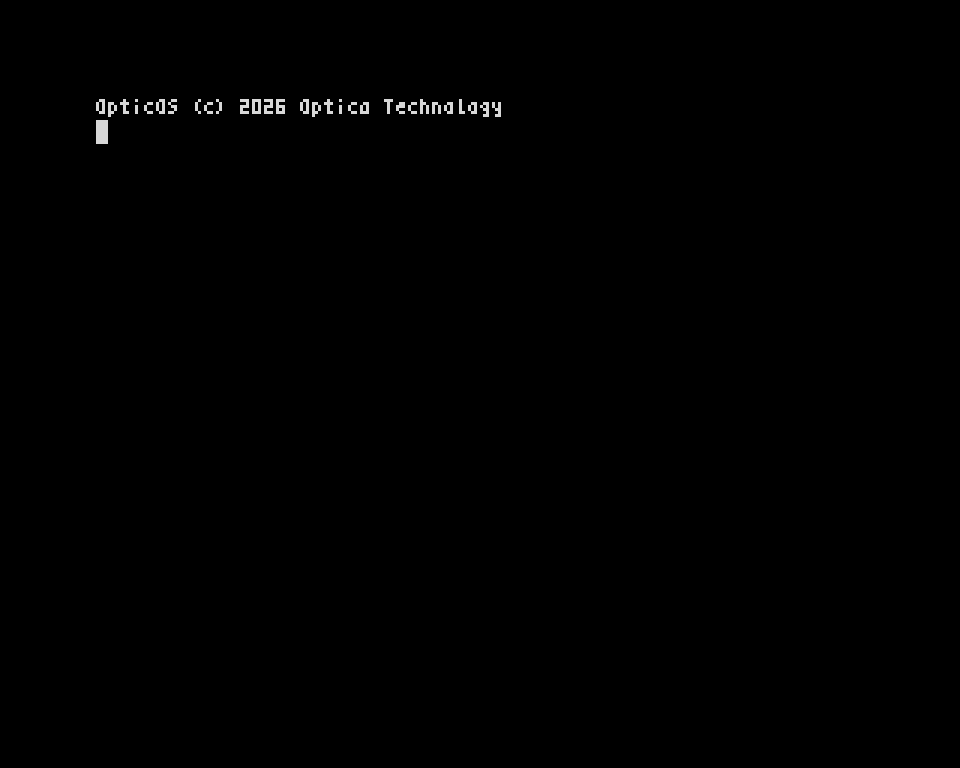

# OpticOS



*A clean-room replacement 16K ROM for the 48K ZX Spectrum.*

**OpticOS** is a new operating environment and BASIC, **OpticBASIC**, for the Sinclair ZX Spectrum. It boots from a 16,384-byte ROM, just as the original did, but the language has no line numbers: you write named procedures and functions in a full-screen editor, on a 64-column display that uses a condensed 4-pixel font.

The boot message reads:

```
OpticOS (c) 2026 Optica Technology
```

Status: **Phase 2 complete** (maths package). Phase 1 brought boot, screen, keyboard, tape and the legacy loader: the ROM boots in Fuse and in the headless rig, and loads ordinary game tapes with `LOAD ""` from a real tape signal, with traps off. Phase 2 added clean-room floating point (+ − × ÷ ^, SIN COS TAN ATN ASN ACS EXP LN LOG SQR INT ABS SGN RND, STR$/VAL) and a direct-mode `PRINT` / `?` at the `]` prompt, so `PRINT "Hello, World!"` and `PRINT 2+2, SQR 2` work. The rest of OpticBASIC is Phases 3–4. The design is in [`docs/spec.md`](docs/spec.md). The reports are in [`docs/phase1/`](docs/phase1/README.md) and [`docs/phase2/`](docs/phase2/README.md), and the maths API is in [`docs/maths.md`](docs/maths.md).

## Building

```
make                # or ./build.sh : assembles build/opticos.rom (16,384 bytes) with pasmo
make check          # headless rig tests (add REF=/path/to/48.rom for the reference comparisons)
fuse-sdl --machine 48 --rom-48 build/opticos.rom --no-traps
```

`build/` is gitignored. You need `pasmo` 0.5.3, `gcc` and Python 3 with Pillow.

## Planned features

- A drop-in 16K ROM image for the 16K and 48K Spectrum, for real hardware and for emulators such as Fuse.
- **OpticBASIC**, a structured BASIC with no line numbers: named procedures and functions with parameters and `LOCAL`, block `IF` / `ELSEIF` / `ELSE` / `ENDIF`, `WHILE`, `REPEAT`, `FOR`, `CASE`, labels in place of line-number `GOTO`, and `TRY` / `CATCH` error handling.
- **64-column text** as the default, using an original 4×8 condensed font (in the spirit of Tasword Two, but drawn from scratch), with a `MODE 32` switch.
- A **full-screen editor**. Keywords are typed letter by letter and tokenised; there is no single-key keyword entry.
- **Tape compatibility.** The standard ROM tape encoding is kept, so ordinary TAP and TZX files load, and files saved by OpticOS load on other tools.
- **Machine-code compatibility** at the cheap, well-known entry points: the RST vectors, IM 1, NMI, `LD-BYTES`, `SA-BYTES` and `BEEPER`, among others. Existing BASIC programs are not expected to run, aside from a small legacy loader subset used by tape loaders.
- A speed target of at least 3× Sinclair BASIC on integer loops, using a 16-bit integer fast path.
- **Clean-room implementation.** OpticOS contains no Sinclair, Amstrad or Tasword code or artwork.

## The boot screen

The mock-up above matches the ROM's real boot screen pixel for pixel (the rig checks this). It is a faithful ZX Spectrum frame: 256×192 pixels of bitmap, with a 32-pixel black border, giving a 320×256 image (and a 3× nearest-neighbour upscale here so the text is readable). Paper is black, ink is white, bright is off.

Row 0 is a colour bar made from attribute cells only: 16 swatches, each two cells wide, showing black, blue, red, magenta, green, cyan, yellow and white, first normal and then BRIGHT. Row 1 is blank. Row 2 holds the banner, `OpticOS (c) 2026 Optica Technology`, and row 3 the BASIC's name and version, `OpticBASIC v0.1`. Row 4 is blank. Row 5 shows the OpticOS prompt `] ` with the cursor block (character 127) at column 2. `]` is the direct-mode prompt everywhere. Everything below the bar is white on black. The font has no copyright glyph — a © is illegible at 3 pixels wide — so the banner uses ASCII `(c)`, as the specification requires.

The native 1× frame is [`assets/opticos_boot.png`](assets/opticos_boot.png).

## The font

The default character set is a 96-glyph 4×8 font (codes 32–127), with a 3-pixel-wide ink grid and a fourth blank column so neighbours have a gap. Two glyphs are packed per byte, which comes to 384 bytes, destined for `$3E80–$3FFF` in the ROM. Code 127 is the editor cursor and wrap mark.

The artwork is original. The idea of a 64-column Spectrum display comes from Tasword Two (Tasman Software, 1983); the bitmaps do not.

| File | What it is |
|---|---|
| [`font/font4.txt`](font/font4.txt) | ASCII-art source for every glyph |
| [`font/font4x8.py`](font/font4x8.py) | The same glyphs, plus the packed 384-byte image |
| [`font/font4x8.bin`](font/font4x8.bin) | Packed font, ready to assemble at `$3E80` |
| [`font/make_font.py`](font/make_font.py) | Regenerates the font files and the boot mock-up |
| [`assets/font_sheet.png`](assets/font_sheet.png) | A labelled sheet of all 96 glyphs |

## What is not in this repository

A Sinclair `48.rom` image is **not** included, and never will be. If a later test rig needs one as a behavioural reference, you must supply your own and keep it out of the tree (`roms/` and `*.rom` are gitignored).

## Licence

Code is under the MIT licence. Artwork and text are under [CC BY 4.0](https://creativecommons.org/licenses/by/4.0/). See [LICENSE](LICENSE).

Copyright (c) 2026 Optica Technology.
