# Introduction

OpticOS is a new 16K ROM for the 48K ZX Spectrum. It replaces the Sinclair ROM, and it brings its own language, **OpticBASIC**: a structured BASIC with named procedures and functions, block IF, CASE, WHILE, REPEAT and TRY, and no line numbers at all. Text is printed at **64 columns** in a 4-pixel font, so a listing shows twice as much as on a Sinclair screen.

OpticOS keeps the parts of the Spectrum that other software relies on. The tape format is the standard one, and the ROM routines that games call, such as `LD-BYTES` and `BEEPER`, are at their usual addresses. Ordinary commercial games load with `LOAD ""` through a small legacy loader that understands the BASIC loader programs on their tapes.

OpticOS is a clean-room design. It contains no Sinclair, Amstrad or Tasword code or artwork, and every build is checked to make sure that no run of 12 or more bytes is shared with the original ROM.

This manual describes OpticOS and OpticBASIC exactly as they are built. Every example in it was typed into the ROM and run, and the screenshots come from the Fuse emulator with its tape traps turned off.

## What you need

- A 48K ZX Spectrum, or an emulator. OpticOS also starts on a 16K machine, with less room for programs.
- The ROM file `opticos.rom` (16,384 bytes). In Fuse, start with `fuse --machine 48 --rom-48 opticos.rom --no-traps` to load from the real tape signal, as on a real Spectrum, or leave the tape traps on to load `.tap` files at once (this needs ROM v1.0.1 or later; v1.0 itself needs `--no-traps`). On real hardware the ROM goes in an EPROM in place of the original; this has not yet been tried.

## How this manual is laid out

Chapters 2 to 4 cover starting up, the keyboard and screen, and typing in and editing programs. Chapter 5 describes the language, and chapter 6 is an A–Z reference of every keyword and function. Then come errors, tape, graphics and sound, machine code, and the memory map. Chapter 12 lists the limits and the differences from Sinclair BASIC, and chapter 13 has worked examples.

In syntax lines, `[ ]` marks something optional, `|` separates alternatives, and `…` means "more of the same". Names in *italics* stand for something you supply.

# Getting started

## The start-up screen

Switch on, and after a moment OpticOS draws its start-up screen and plays two notes: a short high one, then a longer low one. They are the BBC Micro's power-on tones played in reverse order, 523 Hz for 0.3 seconds and then 122 Hz for 0.9 seconds. Keys pressed while they play, or in the moment after, are ignored: start typing once the `]` prompt appears. (So when an emulator such as Fuse auto-loads a tape by typing `LOAD ""` for you after a reset, the typing is ignored and you get a clean prompt; type `LOAD ""` yourself.) `NEW` restarts the machine in the same way, so it plays them too.

<figure>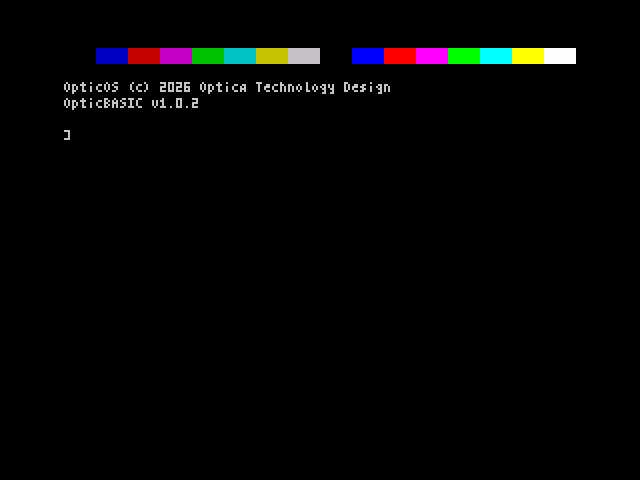<figcaption>The start-up screen in Fuse.</figcaption></figure>

The top row is a colour bar showing the eight Spectrum colours, normal and then bright. Below it are the copyright line, `OpticOS (c) 2026 Optica Technology Design`, and the name and version of the BASIC. Then comes the prompt.

## The prompt

`]` followed by a space is the OpticOS prompt. Whatever you type at it is run as soon as you press ENTER:

```
] PRINT "Hello, world!"
Hello, world!
] PRINT 2+2, SQR 2
4               1.41421356
```

The prompt changes to show what ENTER will do. `]` means run the line, `+` means add it to the program (AUTO mode), and `*` means put it back in place of the line being edited (chapter 4).

# The keyboard and the screen

## Typing keywords

OpticOS ignores the keyword legends printed on the Spectrum's keys. Keywords are typed **letter by letter**, like any other word, and recognised when you press ENTER. Upper or lower case does not matter: `print`, `Print` and `PRINT` are the same, and LIST always shows keywords in capitals.

| Key | What it does |
|---|---|
| Letters and digits | Lower case. Hold CAPS SHIFT for capitals. |
| SYMBOL SHIFT + key | The red symbol on the key: `"` is SYMBOL+P, `;` is SYMBOL+O, `=` is SYMBOL+L, and so on |
| CAPS SHIFT + SYMBOL SHIFT, then a key | One extra symbol: `[ ] { } \ | ~` on Y, U, F, G, D, S and A |
| CAPS+5 / CAPS+8 | Move the cursor left / right in the line you are typing |
| CAPS+0 (DELETE) | Delete the character to the left of the cursor |
| CAPS+7 / CAPS+6 | Move the current-line marker up / down the program, and relist |
| CAPS+1 (EDIT) | Copy the current line into the input line; press again to empty it |
| ENTER | Run the line, or put it into the program |
| CAPS+SPACE (BREAK) | Stop a running program |

The input line holds up to 126 characters, which is two screen rows. New characters are inserted at the cursor.

## The 64-column screen

The screen has 24 rows of 64 columns. Rows are numbered 0–23 from the top and columns 0–63 from the left, for `PRINT AT`. The font is OpticOS's own, 4 pixels wide, with true lower case and descenders. Character codes 32–127 print; code 127 is the block used as the cursor, and codes 128–255 print as `?`.

There is no separate lower screen. Everything, including error messages and the prompt, appears in the main screen, which scrolls up when the bottom is reached.

**Colour clash.** Colours on the Spectrum belong to 8×8 pixel cells, and at 64 columns each cell holds **two** characters (columns 0 and 1, 2 and 3, and so on). Printing a character in a new colour recolours its neighbour too. To keep colours tidy, change colour on even-numbered columns.

# Entering and editing programs

## Programs without line numbers

An OpticBASIC program is a list of lines with no numbers. You add lines with `AUTO`, move about with a **current-line marker**, and change a line by copying it into the input line with EDIT. LIST shows the program indented to show its structure. The indentation is worked out each time and is not stored, so a program always lists tidily however you typed it.

## Typing a program: AUTO

Type `AUTO`. The prompt changes to `+`, and each line you type now goes into the program **after the current line** and becomes the current line, so you type a program from top to bottom. An empty line (just ENTER) ends AUTO mode.

```
] AUTO
+ FOR i = 1 TO 3
+ PRINT i; " squared is "; i * i
+ NEXT
+
] RUN
1 squared is 1
2 squared is 4
3 squared is 9
```

## LIST and the marker

`LIST` lists the whole program, with `>` in front of the current line. CAPS+7 and CAPS+6 move the marker up and down one line and relist about ten lines either side of it. If you move up from the first line, the marker goes *above* it, and the next line you add goes at the top of the program.

<figure>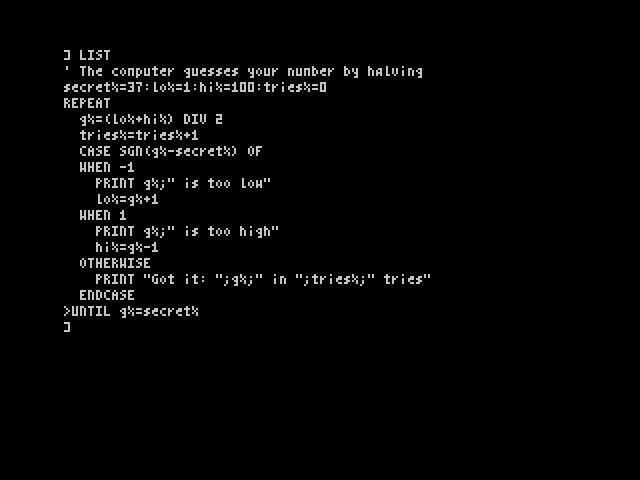<figcaption>LIST shows the structure by indentation. The marker is on the last line.</figcaption></figure>

## Changing and deleting lines: EDIT

Put the marker on a line and press **EDIT** (CAPS+1). The line appears in the input line, without its indentation, and the prompt becomes `*`. Change it with the cursor keys and DELETE, and press ENTER to put it back in place of the old line.

To **delete** a line, put the marker on it and press EDIT twice (the second press empties the input line), then ENTER. The line before it becomes current.

<figure>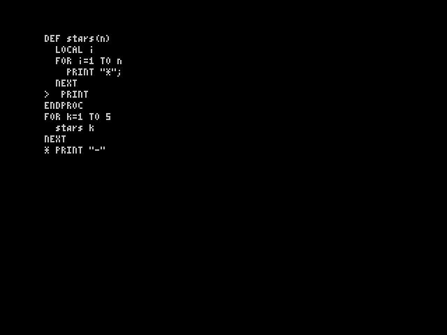<figcaption>Editing: the marker is on the empty PRINT, and the new text is in the input line after the * prompt.</figcaption></figure>

## Things to know

- Every change to the program clears the variables, and the program is checked again before the next RUN.
- `NEW` restarts OpticOS exactly as at power-on: the program, its variables and any machine code are wiped, and you get the start-up screen and chime again. `LOAD` replaces the program and variables.
- `RUN` runs the program from the top. `RUN` *name* runs just one procedure (chapter 6).
- When a program stops with an error, the line with the error becomes the current line, so EDIT brings it straight up.

# The language

## Lines and statements

Put one statement on each line. You can join statements with `:`, but you never need to. A comment starts with `REM` or `'` and runs to the end of the line.

The block keywords, `IF` (block form), `ELSEIF`, `ELSE`, `ENDIF`, `WHILE`, `WEND`, `REPEAT`, `UNTIL`, `CASE`, `WHEN`, `OTHERWISE`, `ENDCASE`, `TRY`, `CATCH`, `ENDTRY`, `DEF` and `ENDPROC`/`ENDFN`, must each **start a line**.

## Names and types

A name starts with a letter, followed by letters, digits or `_`, up to 32 characters, all of them significant. Names are not case-sensitive. The ending says what the variable holds:

| Form | Type | Range |
|---|---|---|
| `count` | Number (floating point) | about ±1.7E38, 9 to 10 significant digits; whole numbers −65535 to 65535 are held exactly and work fastest |
| `count%` | 16-bit integer | −32768 to 32767; storing a value outside this is an Overflow error |
| `name$` | String | 0 to 255 characters |
| `a(9)`, `b%(3,3)`, `n$(20)` | Arrays of any type, made with DIM | up to 3 dimensions, counted from 0 |

A variable comes into being the first time something is stored in it. Using one before then is the error "No such variable".

**Truth values.** A comparison gives −1 for true and 0 for false, and `TRUE` and `FALSE` are −1 and 0. `IF`, `WHILE` and `UNTIL` treat any non-zero value as true.

## Numbers and strings

Numbers can be written as `123`, `1.5`, `1.5E-3`, in hex as `$C000` or `&C000`, or in binary as `%10110001`. Strings go in double quotes; to put a quote inside a string, write it twice: `"Say ""hello"""`.

## Operators

From highest priority to lowest:

| Priority | Operators | Notes |
|---|---|---|
| 1 | `( )`, functions, array subscripts | |
| 2 | `^` | power; `2^3^2` is `2^9` |
| 3 | unary `-`, `+`, `NOT` | |
| 4 | `*` `/` `DIV` `MOD` | `/` always gives a full result, `7/2` = 3.5; `DIV` divides and drops the fraction, `7 DIV 2` = 3 |
| 5 | `+` `-` | `+` also joins strings: `"a" + "b"` = `"ab"` |
| 6 | `<<` `>>` | shift an integer left or right: `1 << 4` = 16 |
| 7 | `=` `<>` `<` `>` `<=` `>=` | compare numbers, or strings in character order |
| 8 | `AND` | bitwise on whole numbers |
| 9 | `OR` `XOR` | bitwise on whole numbers |

## Procedures and functions

A **procedure** is a named block of lines between `DEF name` and `ENDPROC`. You call it by writing its name, with any arguments after it, with or without brackets:

```
DEF PROC greet(who$, times%)
  LOCAL i%
  FOR i% = 1 TO times%
    PRINT "Hello, "; who$
  NEXT
ENDPROC
greet "Nathan", 2
```

A **function** returns a value with `RETURN`, and ends with `ENDFN`. A one-line function can be written `DEF FN name(params) = expression`:

```
DEF FN area(w, h)
  RETURN w * h
ENDFN
DEF FN sq(n) = n * n
PRINT area(3, 4) + sq(2)
```

The words `PROC` and `FN` after `DEF` are optional, and so is `FN` in a call. Arguments are passed **by value**. Arrays cannot be passed, but every array is global, so a procedure can use one by name.

A name must not be a keyword. OpticBASIC would read `DEF PROC run` as the keyword RUN, so RUN stops with error 21, "Keyword as name", at that DEF line before the program starts. Choose another name, such as `run_it` or `cosine`.

`LOCAL` (at the start of a procedure or function) and the parameters give the procedure its own copies of those variables. The old values come back when it ends, or when an error leaves it. Procedures and functions can call themselves (recursion). The program's main part is simply the lines that are not inside a `DEF`.

## Control structures

```
IF condition THEN statement [ELSE statement]     ' one line

IF condition                                       ' block
  …
ELSEIF condition
  …
ELSE
  …
ENDIF

WHILE condition … WEND            ' test first
REPEAT … UNTIL condition          ' test after
FOR v = first TO last [STEP s] … NEXT [v]

CASE expression OF
  WHEN value [, value …]
    …
  OTHERWISE
    …
ENDCASE

EXIT FOR | EXIT WHILE | EXIT REPEAT
TRY … CATCH … ENDTRY
```

`CASE` compares the expression with each `WHEN` value in turn, runs the first branch that matches (or the `OTHERWISE` branch), and carries on after `ENDCASE`. The values can be numbers or strings, but must be the same type as the expression. A `WHEN` branch can follow on the same line after a `:`.

`EXIT FOR`, `EXIT WHILE` and `EXIT REPEAT` leave the innermost loop of that kind, carrying on after its NEXT, WEND or UNTIL.

# Reference

Every keyword and function OpticBASIC has, in alphabetical order. *n*, *x* and *a* stand for numeric expressions, *s$* for a string expression, and *v* for a variable.

<div class="ref" markdown="1">

**ABS** *x* — The value without its sign. `PRINT ABS -3` gives 3.

**AND** — Logical or bitwise "and". `IF x > 0 AND x < 10 THEN PRINT "digit"`; `6 AND 3` is 2.

**ASC** *s$* — The character code of the first character. `ASC "A"` is 65.

**AT** — Used in PRINT: `PRINT AT row, column; …` (row 0–23, column 0–63).

**ATN** *x* — Arctangent, in radians. `PRINT ATN 1 * 4` gives 3.14159265.

**AUTO** — Start adding typed lines to the program after the current line (prompt `+`). An empty line stops.

**BEEP** *duration*, *pitch* — Play a note. Duration is in seconds; pitch is in semitones above middle C (0), from about −24 to 69. `BEEP 0.5, 7` plays the G above middle C for half a second.

**BORDER** *n* — Set the border colour, 0–7. `BORDER 1` makes it blue.

**BRIGHT** 0|1|8 — Bright colours off or on for what is printed or plotted next; 8 keeps the brightness already on the screen. Also inside PRINT: `PRINT BRIGHT 1; "Hi"`.

**CALL** *addr* — Run machine code at *addr*. It returns to BASIC with `RET`. `CALL 32768`

**CASE** *x* **OF** — Start a CASE block (chapter 5). `CASE k% OF`

**CATCH** — Starts the part of a TRY block that runs if an error happened (chapter 7).

**CHR$** *n* — The character with code *n* (0–255). `CHR$ 65` is "A".

**CLEAR** [*n*] — Forget all variables, open loops and procedure calls. With *n*, also move RAMTOP (the top of BASIC's memory) to *n*, leaving the memory above it free for machine code: `CLEAR 59999`. *n* must leave room for BASIC's stacks between the variables and *n*: 4,864 bytes on a 48K machine, 2,048 on 16K. Use CLEAR at the top level of a program, not inside a procedure.

**CLS** — Clear the screen to the current paper colour, and print from the top.

**CODE** — Used in SAVE, LOAD and VERIFY for blocks of memory (chapter 8).

**COS** *x* — Cosine of *x* radians.

**DATA** *item* [, *item* …] — Values for READ. Items can be any expressions, numbers or strings. A DATA statement must start its line. `DATA "pear", 3, 2*4`

**DEF** *name*[(*params*)] — Start a procedure (ending `ENDPROC`) or function (ending `ENDFN`). The name cannot be a keyword (error 21). `DEF PROC move(dx)`, `DEF FN half(x) = x / 2`

**DIM** *a*(*n* [, *n* [, *n*]]) — Make an array with up to 3 dimensions, each counted from 0, so `DIM a(9)` has 10 elements. Numbers start as 0 and strings as "". Making the same array twice is an error. `DIM board%(7,7)`, `DIM name$(20)`

**DIV** — Whole-number division: `17 DIV 5` is 3.

**DPEEK** *addr* — The 16-bit value at *addr* and *addr*+1, low byte first. `DPEEK 23675`

**DPOKE** *addr*, *n* — Store a 16-bit value, low byte first. `DPOKE 32000, 1234`

**DRAW** *dx*, *dy* — Draw a line from the last point plotted, *dx* across and *dy* up. **DRAW TO** *x*, *y* draws to an absolute position. `PLOT 0,0: DRAW 255,0: DRAW TO 128,191`

**ELSE**, **ELSEIF** *condition* — Parts of an IF block; ELSE also in a one-line IF.

**END** — Stop the program quietly.

**ENDCASE**, **ENDIF**, **ENDTRY** — End a CASE, IF or TRY block.

**ENDFN**, **ENDPROC** — End a function or procedure. ENDPROC can also be used earlier, to leave a procedure: `IF l < 4 THEN ENDPROC`.

**ERR** — The number of the last error (table in chapter 7).

**ERR$** — The message of the last error. After `ERROR n, msg$` it is *msg$*.

**ERROR** *n* [, *msg$*] — Cause error number *n* (0–255). With a message, the error report reads *msg$* and ERR$ gives *msg$*; up to 28 characters are kept. Without a message, an error number OpticOS has no message for is reported as `Error n` and ERR$ is "". `ERROR 200, "Out of fuel"`

**EXIT FOR** | **EXIT WHILE** | **EXIT REPEAT** — Leave the innermost loop of that kind. `IF KEY(" ") THEN EXIT FOR`

**EXP** *x* — e to the power *x*. `EXP 1` is 2.71828183.

**FALSE** — 0.

**FLASH** 0|1|8 — Flashing off or on for what is printed or plotted next; 8 keeps the flashing already on the screen. Also inside PRINT.

**FN** — Optional before a function's name, in DEF or in a call.

**FOR** *v* = *first* **TO** *last* [**STEP** *s*] — Repeat the lines up to NEXT, counting *v* from *first* to *last*. The loop does not run at all if *first* is already past *last*. `FOR i = 10 TO 1 STEP -3` gives 10, 7, 4, 1.

**FRAMES** — The number of frames (fiftieths of a second) since the machine was switched on. Use it for timing: `t = FRAMES: …: PRINT (FRAMES - t) / 50; " s"`.

**FREE** — The number of bytes free for variables and strings. `PRINT FREE`

**HEX$** *n* — *n* as four hex digits. `HEX$(255)` is "00FF".

**IF** *condition* **THEN** *statement* [**ELSE** *statement*], or the block form (chapter 5).

**IN** *port* — Read an input port. `IN 31` reads a Kempston joystick: bit 0 right, 1 left, 2 down, 3 up, 4 fire.

**INK** *n* — Set the ink colour, 0–7, for what is printed or plotted next; 8 means keep the colour already on the screen. Also inside PRINT: `PRINT INK 2; "red"`.

**INKEY$** — The key being pressed now, or "" if none. It does not wait.

**INPUT** ["*prompt*";] *v* [, *v* …] — Ask for values. Each variable gets its own line, edited with the usual keys. Numbers are read as by VAL. `INPUT "Your name? "; n$`

**INSTR**(*s$*, *t$* [, *start*]) — The position of *t$* in *s$*, from 1, or 0 if it is not there. `INSTR("hello", "l")` is 3; `INSTR("hello", "l", 4)` is 4.

**INT** *x* — The whole number at or below *x*. `INT 2.7` is 2, `INT -2.5` is −3.

**INVERSE** 0|1 — Swap ink and paper in text, and make PLOT and DRAW clear pixels. It stays set after a PRINT that uses it.

**KEY**(*k$*) — TRUE while the key for the first character of *k$* is held down. It works for letters, digits and " " (space), and several keys can be tested at once, which suits games: `IF KEY("q") AND KEY("p") THEN …`.

**LEFT$**(*s$*, *n*) — The first *n* characters. `LEFT$("hello", 2)` is "he".

**LEN** *s$* — The length of a string.

**LET** — Optional: `LET x = 1` is the same as `x = 1`.

**LIST** — List the whole program, indented, with `>` at the current line.

**LN** *x* — Natural logarithm. **LOG** *x* — Logarithm to base 10. `LOG 1000` is 3.

**LOAD** "*name*" | **LOAD** "" — Load a program from tape (chapter 8). **LOAD** "*name*" **CODE** [*start*] loads a block of memory.

**LOCAL** *v* [, *v* …] — Give a procedure or function its own copies of variables. Use it on the first lines of the procedure. `LOCAL x2, y2`

**MAX**(*a*, *b*), **MIN**(*a*, *b*) — The larger or smaller of two numbers.

**MID$**(*s$*, *start* [, *n*]) — *n* characters from position *start* (from 1), or the rest of the string. `MID$("hello", 2, 3)` is "ell".

**MOD** — The remainder after division: `10 MOD 3` is 1.

**NEW** — Restart, exactly as at power-on: memory is tested and cleared (the program, all variables and anything POKEd or loaded as CODE), `CLEAR`'s RAMTOP and the colours go back to their defaults, and the start-up screen, banner and chime appear.

**NEXT** [*v*] — End a FOR loop.

**NOT** *x* — Logical or bitwise "not". `NOT 0` is −1 (TRUE).

**OF** — Used in CASE.

**OR**, **XOR** — Logical or bitwise "or" and "exclusive or". `5 XOR 3` is 6.

**OTHERWISE** — The branch of a CASE that runs when no WHEN matches.

**OUT** *port*, *n* — Send a byte to an output port. `OUT 254, 2` sets the border red.

**OVER** 0|1 — With OVER 1, text and lines are combined with what is already on the screen, so drawing twice removes them. It stays set after a PRINT that uses it.

**PAPER** *n* — Set the background colour, 0–7, for what is printed or plotted next; 8 means keep the colour already on the screen. Also inside PRINT.

**PEEK** *addr* — The byte at *addr*. **POKE** *addr*, *n* stores one.

**PI** — 3.14159265.

**PLOT** *x*, *y* — Set the pixel at *x* (0–255 across) and *y* (0–191 up from the **bottom**). `PLOT 128, 96`

**PRINT** [*items*] — Print numbers and strings. Between items, `;` leaves no gap, `,` moves to the next 16-column zone, and `'` starts a new line. A `;` or `,` at the end stops the new line. Items can include `AT r, c;`, `TAB(c);` and the colour keywords. `?` is short for PRINT. `PRINT AT 5, 10; INK 6; "Score "; s%`

**PROC** — Optional after DEF: `DEF PROC name` and `DEF name` are the same.

**RANDOMIZE** [*n*] — Start RND's sequence from *n*, so it repeats; with no *n*, from the frame counter.

**READ** *v* [, *v* …] — Take the next values from the DATA lines. Running out is the "Out of DATA" error.

**REM** — A comment; `'` does the same.

**REPEAT** … **UNTIL** *condition* — Repeat the lines until the condition is true. They always run at least once.

**RESTORE** [*name*] — Make the next READ start again from the first DATA line, or from the first DATA line after `DEF name`. That lets each procedure keep its own data.

**RETURN** *x* — Leave a function, giving its value.

**RIGHT$**(*s$*, *n*) — The last *n* characters.

**RND** — A random number from 0 to just under 1. **RND**(*n*) — a random whole number from 1 to *n*. `dice% = RND(6)`

**RUN** [*name*] — Run the program from the start, or just the procedure *name* (one with no parameters), then return to the prompt. RUN clears the variables first.

**SAVE** "*name*" [**AUTO** *proc*] — Save the program to tape; with AUTO, it runs *proc* when it is loaded. **SAVE** "*name*" **CODE** *start*, *length* saves memory (chapter 8).

**SGN** *x* — −1, 0 or 1, the sign of *x*.

**SIN** *x* — Sine of *x* radians. **SQR** *x* — Square root.

**STEP** — Used in FOR.

**STOP** — Stop the program with the report "Stopped". It cannot be caught by TRY or continued.

**STR$** *x* — A number as a string. `STR$ PI` is "3.14159265".

**STRING$**(*n*, *s$*) — *s$* repeated *n* times. `STRING$(3, "ab")` is "ababab".

**SWAP** *a*, *b* — Exchange two variables or array elements of the same type. `SWAP w$(i%), w$(i% + 1)`

**TAB**(*c*) — Used in PRINT: move to column *c*. Note the brackets.

**TAN** *x* — Tangent of *x* radians.

**THEN** — Used in a one-line IF.

**TO** — Used in FOR and in DRAW TO.

**TRUE** — −1.

**TRY** — Start a TRY … CATCH … ENDTRY block (chapter 7).

**UPPER$**(*s$*) — The string in capitals. `UPPER$("Mix")` is "MIX".

**USR** *addr* — Run machine code at *addr* and give back the value of its BC register pair when it returns.

**VAL** *s$* — The number written in a string. `VAL "1.5E3"` is 1500.

**VERIFY** — Check a tape against memory, with the same forms as LOAD.

**WAIT** *n* — Pause for *n* frames (fiftieths of a second). `WAIT 50` waits one second.

**WEND** — Ends a WHILE loop.

**WHEN** *value* [, *value* …] — A branch of a CASE block.

**WHILE** *condition* … **WEND** — Repeat the lines while the condition is true. They may not run at all.

</div>

# Errors and TRY / CATCH

## Error reports

When something goes wrong in a running program, OpticOS stops it and prints a report giving the message and the position of the line, counting the first line of the program as line 1:

```
Division by zero, line 57
```

That line becomes the current line, so pressing EDIT brings it up straight away. A mistake in a line typed at the prompt gives the message alone. CAPS+SPACE (BREAK) stops a program with the report "Break".

## Catching errors

Put lines that might fail between `TRY` and `CATCH`. If an error happens there, or in any procedure called from there, OpticOS gives up those lines and runs the lines after `CATCH` instead. `ERR` and `ERR$` say what went wrong. Any LOCAL variables are restored, and unfinished loops and procedure calls are dropped, on the way out. If no error happens, the CATCH part is skipped.

`ERROR n, msg$` causes an error of your own. Numbers from 100 upwards are free for your own use, and the message becomes both ERR$ and the report.

```
DEF FN ratio(a, b)
  IF b = 0 THEN ERROR 200, "Nothing to divide by"
  RETURN a / b
ENDFN
TRY
  PRINT ratio(1, 0)
CATCH
  PRINT "Error "; ERR; ": "; ERR$
ENDTRY
```

<figure>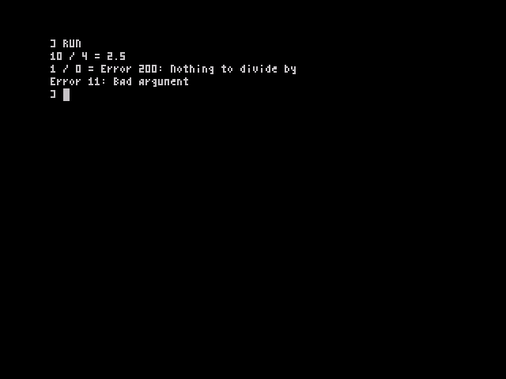<figcaption>The errors example from chapter 13.</figcaption></figure>

BREAK and STOP cannot be caught; they always return to the prompt.

## Error numbers

| ERR | Message | Usual cause |
|---:|---|---|
| 2 | No such variable | A variable used before anything was stored in it |
| 3 | No room | Out of memory, or calls nested too deeply (chapter 12) |
| 4 | Position off screen | PRINT AT outside 0–23, 0–63 |
| 5 | Division by zero | |
| 6 | Overflow | A number too big, or an integer variable outside −32768 to 32767 |
| 7 | Type mismatch | A string where a number was needed, or the other way round |
| 8 | Bad subscript | An array index out of range, or the wrong number of them |
| 9 | Block structure | An IF, loop, CASE, TRY or DEF without its ending, or the reverse |
| 10 | Value outside range | For example PLOT off the screen |
| 11 | Bad argument | For example `SQR -1` or `CHR$ 300` |
| 12 | Break | CAPS+SPACE pressed |
| 13 | Syntax error | A line OpticBASIC cannot make sense of |
| 14 | No such PROC or FN | Calling a name that has no DEF |
| 15 | NEXT but no FOR | |
| 16 | Not in a PROC or FN | ENDPROC, ENDFN or RETURN outside one |
| 17 | Stopped | STOP |
| 18 | Array already made | DIM of an array that exists |
| 19 | String over 255 | A string longer than 255 characters |
| 20 | Out of DATA | READ with no DATA left |
| 21 | Keyword as name | A DEF whose name is a keyword, such as `DEF PROC run` or `DEF FN cos(x)`; reported at the DEF line when the program is RUN |
| 23 | No such stream | |
| 26 | Tape: bad or missing block | A tape error, or BREAK during LOAD |
| 65 | Legacy BASIC: unsupported statement | A Sinclair loader used something the legacy loader does not know (chapter 8) |

# Tape

OpticOS uses the standard Spectrum tape signal and headers, so its tapes can be read by other tools, and tape images (`.tap` and `.tzx`) work in emulators. Emulators that load `.tap` files instantly do it by trapping the ROM's tape routines. ROMs from v1.0.1 on keep the layout these traps expect, and have been tested with Fuse's traps on; The Spectrum from Retro Games has not yet been retested. With v1.0, turn the traps off in Fuse (`--no-traps`); on The Spectrum, v1.0 crashes when loading a `.tap`, so try the `.tzx` tape, which The Spectrum's manual says it plays in real time.

| Command | What it does |
|---|---|
| `SAVE "name"` | Save the program. Names are up to 10 characters. |
| `SAVE "name" AUTO proc` | Save the program so that, once loaded, it runs the procedure *proc* (which must have no parameters) |
| `SAVE "name" CODE start, length` | Save a block of memory |
| `LOAD "name"` or `LOAD ""` | Load the named program, or the first one found. This replaces the program in memory. |
| `LOAD "name" CODE [start]` | Load a block of memory, at the address it was saved from or at *start* |
| `VERIFY "name"` … | Check a saved program or block against memory, with the same forms as LOAD |

To save a picture of the screen, save its memory: `SAVE "pic" CODE 16384, 6912`. While loading, OpticOS shows each header it finds, such as `Bytes: name`. BREAK stops a load.

OpticOS programs are saved with ordinary "Program:" headers, so other tools list them as BASIC programs. Their data begins with a short signature, and that is how `LOAD` tells an OpticBASIC program from a Sinclair one.

## Loading commercial games

Almost every commercial tape starts with a short Sinclair BASIC program that loads the rest, such as:

```
10 BORDER 0: CLEAR 32767: LOAD ""CODE : RANDOMIZE USR 32768
```

When `LOAD ""` finds a Sinclair BASIC program, OpticOS hands it to its **legacy loader**, which runs the statements such loaders use: `BORDER`, `PAPER`, `INK`, `BRIGHT`, `CLS`, `CLEAR n`, `POKE`, `RANDOMIZE USR`, `LOAD "" CODE` and `LOAD "" SCREEN$`, `PRINT` with text and `AT`, `REM`, `GO TO` and `RUN`, with simple sums, `PEEK`, `USR` and `VAL "…"`. That is enough for the great majority of games, which then run as on the Sinclair ROM. A loader that uses anything else stops with "Legacy BASIC: unsupported statement".

<figure class="pair">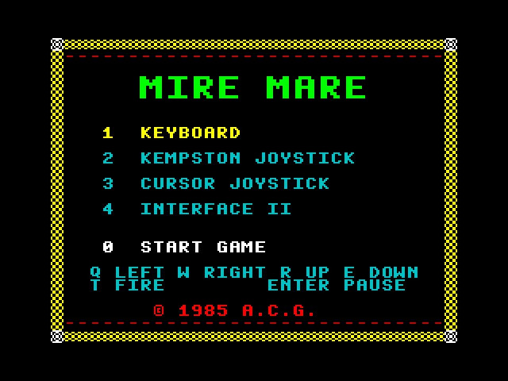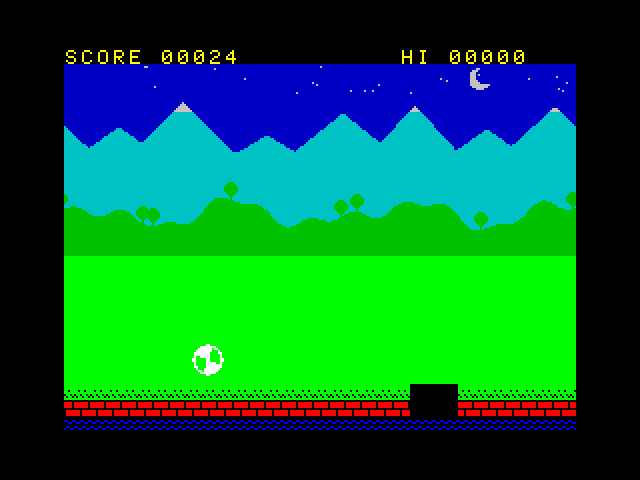<figcaption>Mire Mare's menu and Bounce Ball in play, both loaded with LOAD "" in Fuse with traps off.</figcaption></figure>

Games that call deeper into the Sinclair ROM, for example its calculator or its 8×8 font, will not work (chapter 10).

# Graphics, colour and sound

## Colours

| 0 | 1 | 2 | 3 | 4 | 5 | 6 | 7 |
|---|---|---|---|---|---|---|---|
| black | blue | red | magenta | green | cyan | yellow | white |

`INK`, `PAPER`, `BRIGHT` and `FLASH` set the colours for what is printed or plotted next. Used inside a PRINT, as in `PRINT INK 2; "Danger"`, they last only to the end of that PRINT. `INVERSE` and `OVER` stay set. The value 8 means "keep what is already on the screen": after `PAPER 8`, PRINT, PLOT and DRAW change the ink of each cell they touch but leave its paper as it was, and `INK 8`, `BRIGHT 8` and `FLASH 8` do the same for the other parts. `BORDER` sets the border. `CLS` clears the screen in the current paper colour.

Remember that each colour cell holds two characters (chapter 3).

## Drawing

The graphics screen is 256 pixels across by 192 up, with (0, 0) at the **bottom left**. `PLOT x, y` sets a pixel. `DRAW dx, dy` draws a straight line from the last point by the given amounts, and `DRAW TO x, y` draws to a given point. Each cell that a line passes through takes the current colours. With `OVER 1`, pixels are flipped rather than set, so drawing the same line twice rubs it out; with `INVERSE 1` they are cleared.

<figure class="pair">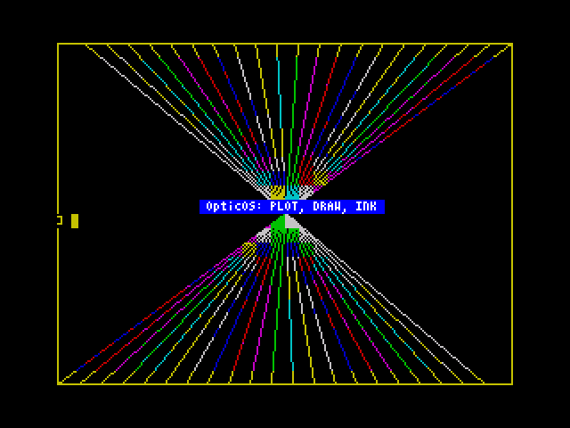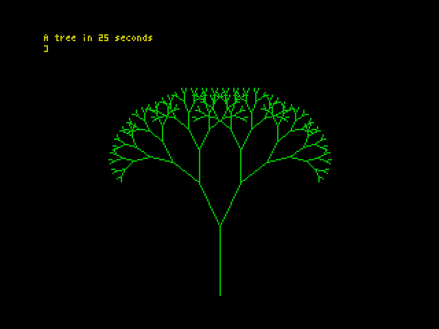<figcaption>PLOT, DRAW and colours; and the recursive tree from chapter 13.</figcaption></figure>

## Sound

`BEEP duration, pitch` plays a note through the speaker: the duration in seconds and the pitch in semitones from middle C. A scale:

```
FOR n% = 0 TO 7
  READ p%: BEEP 0.2, p%
NEXT
DATA 0, 2, 4, 5, 7, 9, 11, 12
```

# Machine code

| | |
|---|---|
| `PEEK a`, `POKE a, n` | Read or write one byte |
| `DPEEK a`, `DPOKE a, n` | Read or write a 16-bit word, low byte first |
| `IN port`, `OUT port, n` | Read or write an I/O port; `IN 31` is a Kempston joystick |
| `CALL a` | Run code at *a*; it returns with `RET` |
| `USR a` | Run code at *a*, and give back BC when it returns |
| `CLEAR n` | Move RAMTOP down to *n*, keeping the memory above it safe from BASIC |

A small example, which puts `LD BC,1234: RET` at address 60000 and runs it:

```
CLEAR 59999
DATA 1, 210, 4, 201
FOR a = 60000 TO 60003: READ b: POKE a, b: NEXT
PRINT USR 60000
```

It prints 1234. CALL has no way to pass register values; POKE them into memory for the code to read, or use USR to get a result back.

## ROM routines

OpticOS keeps the main ROM entry points that games and utilities call, with the usual register contracts:

| Address | Routine |
|---|---|
| `$0000` | Cold start |
| `$0008` | RST 8: error, with the code in the next byte |
| `$0010` | RST 16: print the character in A |
| `$0038` | The 50 Hz interrupt (FRAMES and the keyboard) |
| `$0066` | NMI: jumps to the address in NMIADD if it is not zero |
| `$03B5` | BEEPER: DE = cycles, HL = period |
| `$04C2` | SA-BYTES: IX = start, DE = length, A = flag |
| `$0556` | LD-BYTES: IX, DE, A = flag; carry set to load, clear to verify |
| `$05E3`, `$05E7` | LD-EDGE-2 and LD-EDGE-1, timed to match, for custom loaders |
| `$0D6B`, `$0DAF` | CLS and CL-ALL |
| `$1601` | CHAN-OPEN: A = stream |
| `$203C` | PR-STRING: DE = address, BC = length |
| `$22AA` | PIXEL-ADD: B = y, C = x; gives HL = address, A = bit |

**RST $28 is not the Sinclair calculator.** On OpticOS, `RST $28` enters OpticOS's own floating-point routines, so machine code written for the Sinclair calculator will not work, and nor will the calculator stack routines. Other addresses in the Sinclair ROM hold different code, and nothing should rely on them. The 8×8 font at `$3D00` is not there either.

# Memory map and system variables

## Memory (48K)

| Address | Contents |
|---|---|
| `$0000–$3FFF` | The OpticOS ROM; the 4×8 font is at `$3E80` |
| `$4000–$57FF` | Screen bitmap |
| `$5800–$5AFF` | Screen colours (attributes) |
| `$5B00–$5BFF` | OpticOS working space and the maths registers |
| `$5C00–$5CB5` | System variables (the ones in the table below keep their Sinclair addresses) |
| `$5CB6–$5CCA` | Channel table |
| `$5CCB–$5D4F` | More OpticOS variables: name hash table, editor state; Sinclair loaders are loaded here |
| `$5D50–$5DCF` | The input line |
| `$5DD0–$5DEB` | The message of the last `ERROR n, msg$` |
| `$5DF0` (24048) | Start of the program, then the procedure table and the variables, growing upwards |
| … | Free memory (see `FREE`) |
| below the stacks | The string heap, growing downwards |
| RAMTOP − 4,864 | The typed-line buffer (256 bytes), value stack (512), control stack (2,048), machine stack (2,048); on a 16K machine 256, 512, 768 and 512 bytes, 2,048 in all |
| RAMTOP (`$FF57`) | The last byte BASIC uses; move it with `CLEAR n` |
| `$FF58–$FFFF` | 168 bytes kept free, where Sinclair keeps its UDGs |

On a 16K machine everything from RAMTOP down is 32K lower (RAMTOP is `$7F57`).

## System variables

These keep their Sinclair addresses and meanings:

| Address | Decimal | Name | Use |
|---|---:|---|---|
| `$5C08` | 23560 | LAST_K | The last key pressed |
| `$5C09` | 23561 | REPDEL | Delay before a key repeats (frames) |
| `$5C0A` | 23562 | REPPER | Delay between repeats |
| `$5C36` | 23606 | CHARS | Font address, for machine code |
| `$5C3A` | 23610 | ERR_NR | Error code (IY points here when machine code runs) |
| `$5C3B` | 23611 | FLAGS | Bit 5 is set when a new key is pressed |
| `$5C48` | 23624 | BORDCR | Border colour |
| `$5C4F` | 23631 | CHANS | Channel table address |
| `$5C53` | 23635 | PROG | Start of the program: 24048 (`$5DF0`), or 23755 while a Sinclair loader is loaded |
| `$5C76` | 23670 | SEED | The last RANDOMIZE value |
| `$5C78` | 23672 | FRAMES | Frame counter, 3 bytes |
| `$5C7B` | 23675 | UDG | Points to RAMTOP + 1 |
| `$5C7D` | 23677 | COORDS | The last point plotted (x, then y) |
| `$5C88` | 23688 | S_POSN | Print position: column (0–63), then row |
| `$5C8D` | 23693 | ATTR_P | The current colours |
| `$5C8F` | 23695 | ATTR_T | Colours for the current PRINT |
| `$5C91` | 23697 | P_FLAG | Bit 0 OVER, bit 2 INVERSE |
| `$5CB0` | 23728 | NMIADD | NMI routine address (0 = none) |
| `$5CB2` | 23730 | RAMTOP | The top of BASIC's memory |
| `$5CB4` | 23732 | P_RAMT | The last byte of RAM |

The other Sinclair system variables are used for OpticOS's own purposes, so do not POKE them.

# Limits and differences from Sinclair BASIC

## Limits

| | |
|---|---|
| Program size | All of free memory: about 36,000 bytes on a 48K machine with nothing else loaded, and about 6,500 on 16K |
| Line length | 126 characters typed; the stored line up to 255 bytes |
| Names | Up to 32 characters, all significant |
| Strings | Up to 255 characters |
| Arrays | Up to 3 dimensions |
| Nesting | Recursion goes deep on a 48K machine: a recursive function inside an expression about 56 calls, a procedure with one parameter about 140, and one with a LOCAL as well about 85. Beyond that the report is "No room". On 16K the stacks are smaller (about 50 for a procedure). |
| ERROR message | 28 characters |

## Differences from Sinclair BASIC

- **No line numbers**, so no `GO TO`, `GO SUB`, `CONTINUE` or `LIST n`. Use procedures, loops and CASE.
- **Keywords are typed in full**, letter by letter. The keyword legends on the keys are not used.
- **64 columns**, with no lower screen. `TAB` takes its column in brackets.
- Integer (`%`) variables, long names, structured blocks, procedures with parameters and LOCAL, functions of any length, TRY/CATCH, CASE, SWAP, hex and binary numbers, and `DIV`, `MOD`, `XOR`, `<<`, `>>` are new.
- `RND(n)` gives a whole number from 1 to *n*. `INKEY$`, `KEY()` and `FRAMES` are there for games.
- `/` and `DIV` differ: `7/2` is 3.5, and `7 DIV 2` is 3.
- Arrays count from **0**: `DIM a(9)` makes `a(0)` to `a(9)`. Strings are true strings, not fixed-length character arrays.
- **Not provided:** `CIRCLE` and arcs, user-defined graphics and block graphics (codes 128–255 print as `?`), `SCREEN$()`, `ATTR`, `POINT`, `ASN` and `ACS` (use `ATN(x / SQR(1 - x * x))`), `LPRINT`, `LLIST` and `COPY`, `CAT`, `MERGE`, saving arrays to tape (`SAVE … DATA`), and the Sinclair calculator.
- **Sinclair BASIC programs do not run**, apart from tape loaders (chapter 8).
- Every change to the program clears the variables.
- `STOP` cannot be continued, and BREAK cannot be caught by TRY.

# Worked examples

These programs are in `docs/manual/examples` in the OpticOS repository. Each one was typed into the ROM and run, and the output shown is what the ROM printed. Type them with AUTO; the indentation does not need to be typed, because LIST puts it back.

## Times table

```
INCLUDE times.bas
```

The `TAB(2)` indents each line by two columns, and `INK` sets the colour of the heading.

## Guessing a number

The computer finds a number by halving the range each time, and CASE sorts out the three possible answers.

```
INCLUDE guess.bas
```

<figure>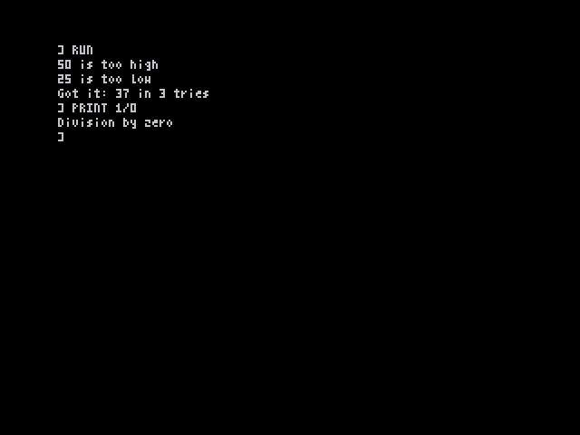<figcaption>The output, followed by an error typed at the prompt.</figcaption></figure>

## Recursive functions

```
INCLUDE fact.bas
```

It prints `0! = 1`, `4! = 24`, `8! = 40320`, `12! = 479001600` and `9 squared = 81`.

## Sorting words

The words are kept in DATA inside a procedure, and `RESTORE words` points READ at them. SWAP exchanges two neighbours that are in the wrong order, until a pass makes no changes.

```
INCLUDE sort.bas
```

<figure>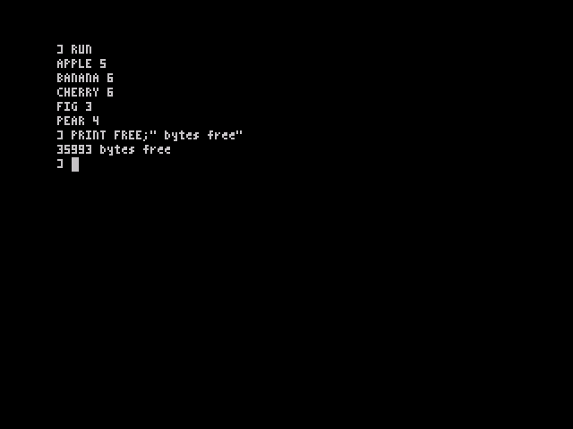<figcaption>APPLE 5, BANANA 6, CHERRY 6, FIG 3, PEAR 4, followed by FREE.</figcaption></figure>

## Catching errors

```
INCLUDE errors.bas
```

The output is `10 / 4 = 2.5`, then `1 / 0 = Error 200: Nothing to divide by` from the program's own ERROR, and `Error 11: Bad argument` from SQR.

## A bouncing ball

The ball moves until it has made 300 moves or SPACE is held down; `EXIT FOR` leaves the loop early.

```
INCLUDE ball.bas
```

<figure>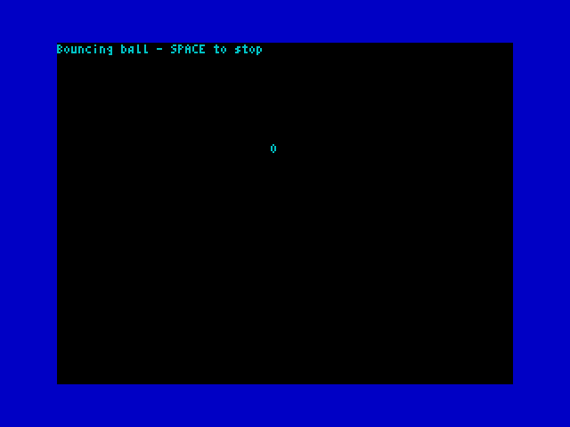<figcaption>The ball in flight.</figcaption></figure>

## A recursive tree

Each branch draws itself and then two smaller branches at an angle, until they are too short to see. LOCAL keeps each call's end point separate.

```
INCLUDE tree.bas
```

It takes about 25 seconds, and prints how long it took.

## The Union Flag

The flag fills the top 16 character rows. The blue field and the central cross are printed as whole colour cells with PAPER; the white diagonals are drawn as short horizontal runs with PLOT and DRAW; and the thin red diagonals are made by clearing pixels with INVERSE 1 over red paper, so the red shows through while the white stays. Because each 8×8 colour cell holds no more than two colours, there is no colour clash. Remember that a colour cell is two of OpticBASIC's 64 text columns wide.

```
INCLUDE flag.bas
```

<figure>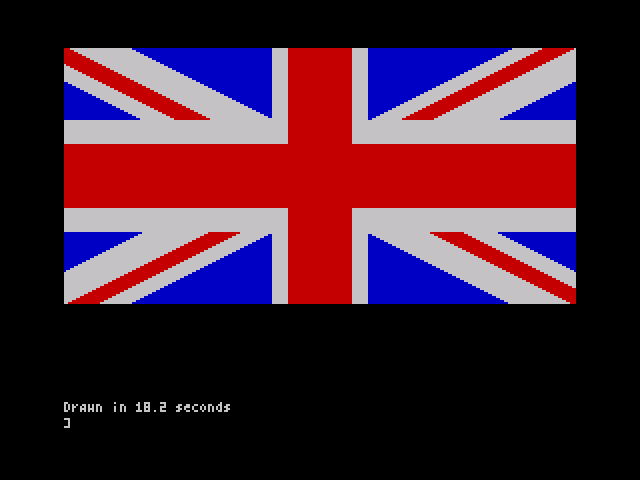<figcaption>The finished flag. It takes about 18 seconds and prints how long it took.</figcaption></figure>

## Happy Bat

Happy Bat is a complete game in the style of Flappy Bird. Fly the bat through the gaps in the pipes and score a point for each one you pass. Touching a pipe, the ground or the sky ends the game. At first the gaps are wide and the pipes far apart, and both close up as the score rises. SPACE flaps the bat's wings and BREAK stops the program. The game is on the example tape: type `LOAD "happybat"` and it runs by itself. Its own repository is [brixham99/happy-bat](https://github.com/brixham99/happy-bat).

<figure class="pair">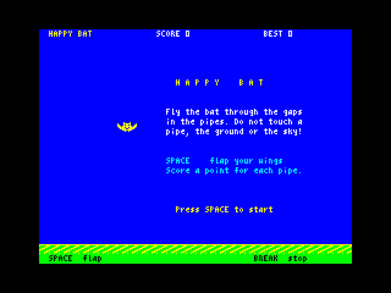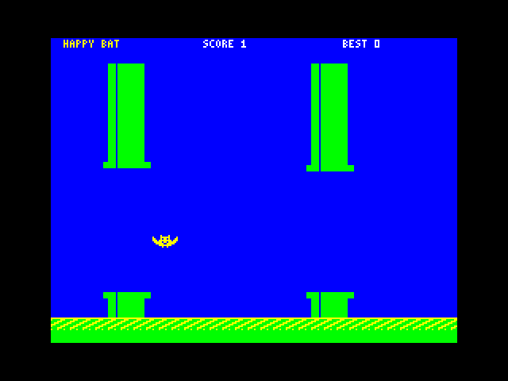<figcaption>The title screen, and the bat flying between two pipes.</figcaption></figure>

The example shows how to share a game between OpticBASIC and machine code. An OpticBASIC statement takes a few hundredths of a second, which is far too slow to move pipes a few pixels at a time. So the work is divided:

* **OpticBASIC** runs the game: the title screen, when each pipe appears and where its gap is, how the game gets harder, the score and best score, the game-over box, and starting again.
* **Machine code** (1,095 bytes at 60000–61094) does everything that touches the screen in each step. It scrolls the ground, moves and draws up to four pipes, reads SPACE, applies gravity and the flap, and draws the bat, checking whether it has hit anything.

One step moves everything 4 pixels and takes two frames, so the game runs at about 23 steps a second. The BASIC loop in PROC `play` is only four statements a step.

CALL and USR cannot pass register values, so BASIC POKEs the values the code needs into a small parameter block, and `USR 60003` hands back the result of each step in BC:

| Address | Use |
|---|---|
| `CALL 60000` | A new playfield: clear it, colour it, draw the ground, no pipes; the bat at rest at line PEEK 60009 |
| `r% = USR 60003` | One step. 0 = flying, 1 = crashed, 2 = a pipe got past the bat (a point) |
| `CALL 60006` | Colour the bat red (game over) |
| 60009 | The bat's top line in the playfield, 0–152 |
| 60010, 60011 | The next pipe's gap: its first line, and the first line below it |
| 60012 | POKE 1 to start that pipe at the right-hand edge |
| 60013 | 1 = play; 0 = title (the ground scrolls; no gravity, no pipes) |
| 60014–60015 | "HB": the code is in memory |
| 60016–60019 | Gravity 2, flap 18, fastest fall 20 (in quarter pixels a step), and 2 frames a step |

The gap starts at 78 lines and closes by 2 lines a point, down to 52 from a score of 13: `MAX(52, 78 - 2 * score%)`. A new pipe comes every 32 steps at first, then one step sooner every 2 points, down to 24 steps.

| Address | Contents |
|---|---|
| 24048–59999 | The program (5,507 bytes), its variables and the stacks. `CLEAR 59999` keeps BASIC below the code |
| 60000–60019 | The jump table (`init`, `step`, `dead`) and the parameter block |
| 60020–60060 | The code's own variables, with a table of four pipes at 60034 |
| 60061–60994 | The code |
| 60995–61094 | The two pictures of the bat (16×8), the ground patterns and the pipe patterns |

The machine code must leave IX, IY and the alternate registers alone, because OpticBASIC uses them. It waits for the next frame with HALT, and reads FRAMES (23672) to pace itself. With the game loaded, `PRINT FREE` shows about 25,400 bytes free, and the figure stays the same however many games are played.

The program starts with `CLEAR 59999`, then loads the code with `LOAD "hbcode" CODE` unless the code is already there. `CLEAR` must be in the main program, not in a procedure, so the tape saves the program with `SAVE "happybat" AUTO start`, and PROC `start` simply does `RUN`.

```
INCLUDE happybat.bas
```

<figure class="pair">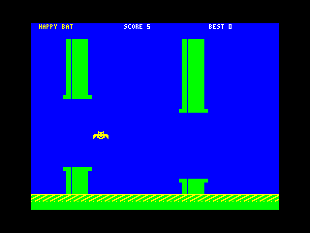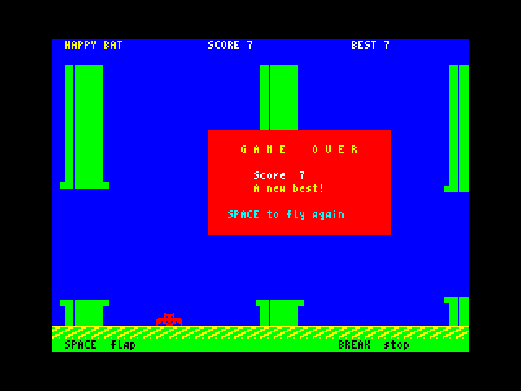<figcaption>The score rising, and a new best score at game over.</figcaption></figure>

### Entering the machine code

You do not need an assembler to make the machine code. The program below holds all 1,095 bytes as DATA lines. Each line has its address, 8 bytes in hex (`$C3` is 195) and a check number: the line's bytes multiplied by 1, 2, 3 … 8 and added together. That catches a mistyped byte, and also two bytes typed the wrong way round. If a line is wrong, the program stops with that line's address, for example `Check the line at 60024`. A line left out stops it with `DATA out of step at …`. The last DATA item is the sum of every byte.

To make your own Happy Bat tape:

1. Type in the game above and save it: `SAVE "happybat" AUTO start`. Leave the tape where it stopped.
2. Type `NEW`, then type in the loader below and RUN it. It does `CLEAR 59999`, POKEs the bytes to 60000–61094 and checks them. Then it saves them, after the program, with `SAVE "hbcode" CODE 60000, 1095`.
3. To play, rewind the tape and type `LOAD ""`. The game runs as soon as it has loaded, and loads `hbcode` from the tape by itself.

If the code is already in memory, the game finds it by the "HB" at 60014 and does not load it again. So straight after step 2 you can rewind and `LOAD ""` the game at once: `LOAD` replaces the program but leaves the code alone. Do not type `NEW` first, because `NEW` restarts the machine and wipes the code too.

```
INCLUDE hbloader.bas
```

The annotated assembler source, `happybat.asm`, is printed in full in the next chapter.

# Happy Bat's machine code

This is the complete source of Happy Bat's machine code. It is written for the pasmo assembler (`pasmo --bin happybat.asm hbcode.bin`). The DATA lines in the previous chapter are its output. Like the rest of OpticOS, it is original, clean-room code: it uses and calls no Sinclair ROM code. It touches only the screen, the keyboard and speaker port, FRAMES and its own variables.

The main routines are:

| Routine | What it does |
|---|---|
| `init` | Clears the playfield, sets its colours, draws the ground and resets the pipes and the bat |
| `step` | One step: wait for the frame, take the bat off, move the bat (`phys`), move and draw the pipes (`pipes`), scroll the ground (`ground`), then test the bat for a crash and draw it again (`bat_on`). Returns 0, 1 or 2 in BC |
| `dead` | Turns the bat's colour cells red |
| `phys` | Reads SPACE on port $7FFE, flaps once per press with a click on the speaker, adds gravity and limits the fall; hitting the top or the ground is a crash |
| `pipes`, `pipe1`, `seg` | Moves each pipe 4 pixels left, starts a new one when BASIC asks, counts a point as a pipe passes the bat, and draws the pipes clipped at the screen edges |
| `ground` | Scrolls the ground 4 pixels with RLD |
| `bat_on`, `bat_off`, `bat_xor` | Tests the bat's 16×8 picture against the screen with AND, then draws or removes it with XOR |
| `pace`, `ln_addr`, `fill` | Waits for the next step, works out a screen line's address, and fills memory |

<div class="asm" markdown="1">

```
INCLUDE happybat.asm
```

</div>

