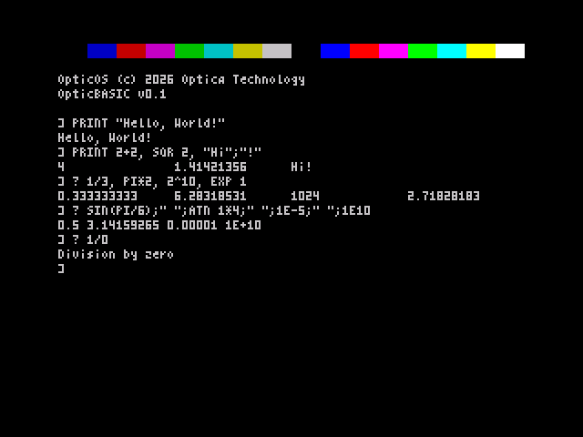

# OpticOS Phase 2 report: the maths package

13 November 2026. This phase adds clean-room floating point (spec items 12–14), a seed of the phase 3
expression evaluator, and a direct-mode `PRINT`. The API, the formats and the algorithms are documented in
[`docs/maths.md`](../maths.md).

## What is implemented

- **Format.** Packed 5-byte floats (Sinclair layout) with a canonical 16-bit small-int form: every integer
  result in −65535…65535 is stored as `00 s lo hi 00`. Fast integer paths cover + − × compare, NEG, ABS, SGN, INT and int↔float.
  Overflow on a fast path quietly falls back to float.
- **Core** (`fpcore.asm`): + − × ÷ on a 40-bit (guard + 32) unpacked accumulator, normalise, round to
  nearest, compare, NEG, ABS, SGN, INT (floor), fp_set_int and fp_get_int (16-bit two's complement and sign).
- **Transcendentals** (`fptrans.asm`): a small byte-code runner (LD/ST/ADD/SUB/MUL/DIV/POLY/NEG on 7 temporaries
  and 19 constants), plus SIN COS TAN ATN ASN ACS EXP LN LOG SQR, `^` (exact repeated squaring for integer
  powers, so `2^10` is the small int 1024), RND (32-bit xorshift) and RANDOMIZE (seeded from FRAMES at boot).
- **Coefficients.** `tools/fpcoef.py` makes OpticOS's own Chebyshev fits with mpmath: sin 5 terms, cos 6,
  atn 6, ln 5, exp 9, which is 31 coefficients and 19 constants in total. It writes `src/gen/*.inc`, and those files are committed so the
  build doesn't need mpmath.
- **Number ↔ text** (`fpconv.asm`): STR$/PRINT formatting (9 significant digits, fixed notation from 1E-5 up to 1E9, otherwise
  `d.dddE±n`) and VAL (`12`, `1.5`, `.5`, `3E8`, `2.5e-3`).
- **Errors** through RST 8 with OpticOS codes: `$05` Division by zero, `$06` Overflow, `$0B` Bad argument,
  `$0D` Syntax error.
- **Expression evaluator** (`expr.asm`, the phase 3 seed): `+ − × ÷ ^`, unary minus, brackets, numbers, `PI`, `RND`
  and the 13 functions, all on a 9-entry value stack.
- **PRINT / `?`** in direct mode: `"strings"` (with `""` for a quote mark), numeric expressions, `;`, `,` (16-column
  zones) and a trailing `;`. `PRINT`, `?`, `CLS` and `LOAD ""` now all go through one command table
  (`cmd_tab`). Anything else gives "Syntax error", replacing the Phase 1 hint message.

## Accuracy and speed

`python3 tools/rig/test_maths.py --n 3000` runs about 3,000 random and edge cases per routine on the Z80 core, checked
against mpmath at 200 bits. The edge cases include 0, ±1, ±65535/65536, 2^±100, 1e±30, values near overflow, cancellation pairs,
multiples of π/2 and the ends of the domains. The full run takes about 2.5 minutes, and the results are in `build/maths_results.{json,md}`. One ulp
is the spacing of the 32-bit mantissa at the result. † means that close to a zero of the result, the error is measured
in absolute units of 2⁻³² (for example SIN near kπ, LN near 1). T-states include the call and are measured
in the rig, with ULA contention, from packed operands to a packed result. The odd high maximum on the trivial
ops is a 50 Hz interrupt landing during the call.

| Op | Routine | Cases | Max error (ulp) | Mean (ulp) | T-states min / mean / max | Mean at 3.5 MHz | Failures |
|---|---|---:|---:|---:|---:|---:|---:|
| + | `fp_add` | 3826 | 0.50 | 0.12 | 561 / 2274 / 6937 | 0.6 ms | 0 |
| − | `fp_sub` | 3809 | 0.50 | 0.10 | 635 / 2789 / 11138 | 0.8 ms | 0 |
| × | `fp_mul` | 3772 | 0.50 | 0.14 | 1636 / 5158 / 9050 | 1.5 ms | 0 |
| ÷ | `fp_div` | 3771 | 0.50 | 0.22 | 10822 / 14407 / 19651 | 4.1 ms | 0 |
| ^ | `fp_pow` | 3008 | 55.04 | 4.73 | 3415 / 115510 / 209053 | 33.0 ms | 0 |
| compare | `fp_cmp` | 3841 | exact | – | 106 / 685 / 3547 | 0.2 ms | 0 |
| negate | `fp_neg` | 3029 | exact | – | 61 / 204 / 2329 | 0.1 ms | 0 |
| ABS | `fp_abs` | 3029 | exact | – | 55 / 140 / 2345 | 0.0 ms | 0 |
| SGN | `fp_sgn` | 3029 | exact | – | 223 / 295 / 2328 | 0.1 ms | 0 |
| INT | `fp_int` | 3029 | exact | – | 22 / 1667 / 6178 | 0.5 ms | 0 |
| SQR | `fp_sqr` | 3008 | 1.00 | 0.49 | 711 / 62872 / 67346 | 18.0 ms | 0 |
| SIN | `fp_sin` | 3010 | 1.07† | 0.20 | 16047 / 74817 / 88100 | 21.4 ms | 0 |
| COS | `fp_cos` | 3010 | 1.08† | 0.24 | 15864 / 76031 / 87544 | 21.7 ms | 0 |
| TAN | `fp_tan` | 3007 | 2.71 | 0.41 | 25615 / 142760 / 160415 | 40.8 ms | 0 |
| ATN | `fp_atn` | 3008 | 1.35 | 0.31 | 10032 / 83484 / 115941 | 23.9 ms | 0 |
| ASN | `fp_asn` | 3007 | 2.04 | 0.55 | 83280 / 160260 / 192144 | 45.8 ms | 0 |
| ACS | `fp_acs` | 3008 | 2.68 | 0.56 | 16576 / 166948 / 193351 | 47.7 ms | 0 |
| EXP | `fp_exp` | 3008 | 0.78 | 0.26 | 18937 / 90917 / 111532 | 26.0 ms | 0 |
| LN | `fp_ln` | 3009 | 0.84† | 0.24 | 17718 / 86181 / 96970 | 24.6 ms | 0 |
| LOG | `fp_log` | 3008 | 2.31† | 0.50 | 19189 / 92368 / 102525 | 26.4 ms | 0 |
| int → float | `fp_set_int` | 3007 | exact | – | 140 / 164 / 2166 | 0.0 ms | 0 |
| float → int | `fp_get_int` | 3779 | exact | – | 92 / 719 / 3241 | 0.2 ms | 0 |
| STR$ / PRINT | `fp_str` | 4539 | 9 digits; 98.9% exact, the rest ±1 in the 9th digit | – | 360 / 74268 / 131619 | 21.2 ms | 0 |
| VAL | `fp_val` | 3016 | 1.97 | 0.21 | 1933 / 55177 / 111105 | 15.8 ms | 0 |
| RND | `fp_rnd` | 3000 | – | – | 6403 / 7063 / 10300 | 2.0 ms | 0 |

Other checks:

- Every overflow, division by zero and domain error raised the right code (counted in Failures). Every integral result in range came back in small-int form.
- STR$/PRINT: 4487/4539 random values match the reference format exactly, and the other 52 differ by one in the 9th digit.
  2998/3000 decimals of up to 8 significant digits, from 1e-30 to 1e38, print exactly as typed.
- VAL(STR$ x): 383/750 come back within 1 ulp and 670/750 within 4 ulp. Nine printed digits can't hold all 32 bits.
- RND: 3000/3000 values in [0, 1), mean 0.4954, χ² over 10 bins = 11.25 (9 degrees of freedom), and `RANDOMIZE n` repeats.
- Console: 13/13 PRINT, `?`, CLS and error lines are as expected (see `rig_hello.png` and `rig_errors.png`).
- Phase 1 regression: `test_phase1.py --ref …/48.rom` gives **35/35**.
- Clean room: `tools/similarity_check.py` finds **no shared 12-byte run** outside the font and the filler.

## PRINT "Hello, World!" in real Fuse

`tools/fuse_phase2.py build/opticos.rom docs/phase2` boots the ROM in fuse-sdl (48K, traps off) and types the lines with real
Spectrum key combinations (`"` is SYMBOL+P, `;` is SYMBOL+O). The screen shows `PRINT "Hello, World!"`,
then `PRINT 2+2, SQR 2, "Hi";"!"`, which gives `4  1.41421356  Hi!` in 16-column zones, then `1/3, PI*2, 2^10, EXP 1`,
`SIN(PI/6);" ";ATN 1*4;" ";1E-5;" ";1E10` and finally `? 1/0`, which shows "Division by zero". The `*` sign looks like `x` in the 4-pixel font.

## Bytes against budget (spec §8.2)

| # | Module | Bytes | Budget | |
|---|---|---:|---:|---:|
| 12 | Float core | 1,424 | 1,100 | **+324 (129%)** |
| 13 | Number ↔ string (plus 50 bytes of legacy `pr_dec`/`pr_hex` already counted here) | 738 | 550 | **+188 (134%)** |
| 14 | Transcendentals, byte-code runner and tables (code 1,070 + data 250) | 1,320 | 950 | **+370 (139%)** |
| | **Maths total** | **3,482** | **2,600** | **+882 (134%)** |
| 18 | Expression evaluator seed and PRINT | 519 | 850 | 61%, and phase 3 will grow it |
| 25 | Console (now with the command table) | 349 | 250 | was 335 in phase 1 |
| 26 | Errors (4 new messages) | 323 | 450 | was 271 |

ROM: 7,813 bytes placed, 8,571 free. **The maths package is over its budget.** The spec's risk table (§8.4) already rates
a 20–30% maths overrun as likely, and its cut list counts ASN/ACS (80) among about 900 recoverable bytes. At 34%, this is a little past that. Taken against the spec's whole-ROM margin
(1,010 bytes), +882 would leave about 128 bytes once every other module reaches its budget. That is below the 256-byte build rule, so the
package needs a size pass, or a re-budget, before phase 3 fills the ROM. Possible savings, roughly estimated:
drop the separate small-int path in STR$ (about 50 bytes); compare by sign check plus same-sign subtraction instead of `fu_cmp` (about 70);
build COS from SIN with one wider polynomial (about 50); an exp rational form with fewer terms (about 25); VAL with a
smaller digit loop (about 60); a register-only xorshift (about 40); drop ASN/ACS, which the brief made optional (about 80).
Together that is about 375 bytes. The rest would need a more stack-oriented, calculator-style core.

## Deviations and limits

- **Over budget**, as above.
- **Error wording.** "Number too big" and "Invalid argument" are word-for-word the Sinclair report texts, and they tripped the
  12-byte clean-room check, so OpticOS says **Overflow** and **Bad argument**.
- **No `&`hex or `%`binary literals yet** (part of spec item 13). They are planned for phase 3, with the tokeniser.
- `^` is left-associative (`2^3^2` = 64, as on the Spectrum). Unary minus binds looser than `^` (`-2^2` = −4).
- SIN, COS and TAN raise Bad argument for |x| > ~102900. Non-integer `^` loses accuracy as |y·ln x| grows (up to 55 ulp).
  Integer `x^-n` overflows when x^n does.
- LOG (base 10) is extra. It costs about 15 bytes plus one constant.
- `LOAD "name"` is still not supported. Only `LOAD ""` is, as in phase 1.

## Files

`src/fpcore.asm`, `src/fpconv.asm`, `src/fptrans.asm`, `src/expr.asm`, `src/gen/*.inc`, `tools/fpcoef.py`,
`tools/rig/mlib.py`, `tools/rig/test_maths.py`, `tools/fuse_phase2.py` and `docs/maths.md`. Changed: `console.asm` (dispatch),
`errors.asm`, `boot.asm` (RND seed), `sysvars.inc` (maths workspace), `opticos.asm`, `check_layout.py` and
`test_phase1.py`. Screenshots: `docs/phase2/fuse_hello.png`, `rig_hello.png` and `rig_errors.png`.
