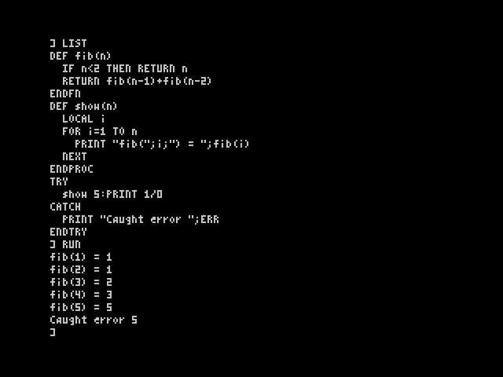

# Phase 3: the OpticBASIC interpreter

*(Since phase 4, program lines are entered with `AUTO` and the line editor instead of the `>` prefix described here; see [`../phase4/`](../phase4/README.md).)*

Phase 3 adds a tokenising interpreter for structured BASIC without line numbers, as set out in [`../spec.md`](../spec.md) §4–§7 and the §12 decisions. The full-screen editor is Phase 4. Until then a program is entered at the `]` prompt one line at a time, with each line starting with `>`:

```
] >DEF fib(n)
] >IF n<2 THEN RETURN n
] >RETURN fib(n-1)+fib(n-2)
] >ENDFN
] PRINT fib(10)
55
```

Any other line runs at once (direct mode). `RUN`, `LIST` and `NEW` work on the stored program.



The screenshot was taken in real Fuse with `--no-traps --no-detect-loader --no-accelerate-loader`, using `tools/fuse_phase3.py`. The program was typed key by key, then listed and run. LIST indents blocks by two spaces. The recursive FN, the PROC with a LOCAL loop variable and the TRY/CATCH around a division by zero all behave as expected.

## What works

| Area | Supported |
|---|---|
| Program store | Tokenised lines `[len] tokens $0D [len]` from `$5D50`, with no line numbers; the DEF table follows the program. A prepass at RUN (or on first PROC/FN use) links IF/ELSEIF/ELSE/ENDIF, WHILE/WEND, REPEAT/UNTIL, TRY/CATCH/ENDTRY and DEF/ENDPROC/ENDFN, and reports mismatches as *Block structure, line n*. |
| Literals | decimal and float (`1.5E3`), `&FF` and `$FF` hex, `%1010` binary, `"strings"` with `""` for a quote |
| Variables | floats `a`, integers `a%` (16-bit; A%–Z% are fixed cells), strings `a$`; names up to 31 characters, case-insensitive keywords, hashed lookup (32 chains) |
| Arrays | `DIM a(10), m%(3,4), s$(5)`: up to 3 dimensions, base 0, any of the three types |
| Statements | PRINT / `?` (with `;` `,` `'` AT TAB), LET or bare assignment, IF … THEN … ELSE … (one line), IF / ELSEIF / ELSE / ENDIF blocks, WHILE / WEND, REPEAT / UNTIL, FOR / TO / STEP / NEXT [v], DEF, ENDPROC, ENDFN, RETURN [value], LOCAL, TRY / CATCH / ENDTRY, ERROR n, END, STOP, REM and `'`, DIM, CLS, RUN, LIST, NEW, BORDER, INK, PAPER, POKE, WAIT, RANDOMIZE, LOAD "" |
| Procedures | `DEF name(a, b$)` … `ENDPROC`, called by bare name: `name 1, "x"` or `name(1, "x")`. Parameters and LOCALs are dynamic (BBC-style) and are restored on exit, including strings. Recursion uses the control stack, not the machine stack. |
| Functions | `DEF sq(x) = x*x` on one line, or a multi-line `DEF f(n)` … `RETURN value` … `ENDFN`. Called in expressions as `f(3)` or `FN f(3)`; recursive. |
| Operators | `^` (right-associative), unary `-` `+` `NOT`, `* / DIV MOD`, `+ -` (`+` joins strings), `<< >>`, `= <> < > <= >=` (numbers and strings, true = −1), `AND`, `OR`, `XOR` |
| Functions (built in) | SQR SIN COS TAN ATN ASN ACS EXP LN LOG INT ABS SGN, PI, RND / RND(n), LEN, LEFT$, RIGHT$, MID$, CHR$, ASC, STR$, VAL, PEEK, ERR, TRUE, FALSE, INKEY$, FRAMES, MAX(…), MIN(…) |
| Strings | A heap growing down from below RAMTOP, with back-pointers and a sliding compactor. The value stack is a GC root, so temporaries survive a compaction mid-expression. Substrings (LEFT$/MID$/RIGHT$) share the block until they are assigned. Strings can be up to 255 characters. |
| Errors | `RST 8` errors unwind to the innermost TRY, restoring the machine and value stacks and any LOCALs. ERR gives the number. Uncaught errors print the message with `, line n` (the line's position in the program). BREAK (Caps Shift + Space) and STOP cannot be caught. `RST $28` still gives the clean *Calculator not supported* error. |

## Tests

| Suite | Result |
|---|---|
| `tools/rig/test_phase3.py` (new) | **49/49**: control flow, PROC/FN, recursion, LOCAL, TRY (including errors inside a nested FN), arrays, string functions, a 1,500-iteration GC stress run, literals, operators, error reporting, LIST round-trip and RST $28 |
| `tools/rig/test_phase1.py` | 35/35, including `LOAD ""` of a real game from an EAR signal |
| `tools/rig/test_maths.py --n 3000` | 0 failures; console lines 13/13 (`foo` now reports *No such PROC or FN*) |
| zexall | all tests OK |
| `tools/similarity_check.py` | OK: no shared run of 12 or more bytes with the Sinclair ROM outside the font and filler |

Speed: a simple `FOR … : a=a+i : NEXT` loop takes about 14,000 T-states per iteration in the rig (about 250 iterations a second at 3.5 MHz). The tokenised format has room for a faster path in Phase 5.

## Memory

From RAMTOP down: machine stack (512 bytes), control stack (768), value stack (320, 5-byte entries), the tokenised direct-mode line (256), then the string heap growing down towards the variables. The interpreter's system variables are at `$5BC8–$5BFB`, the 32 hash-chain heads at `$5CCB` and A%–Z% at `$5D0B`.

## Size

ROM: 13,841 bytes placed, **2,543 free**, in seven gaps between fixed addresses. Phase 3 added about 6.0 KB:

| Module | Bytes | v0.2 budget |
|---|---:|---:|
| Tokeniser, LIST, keyword and dispatch tables | 1,569 | 1,500 (items 15–17) |
| Expression evaluator and functions | 1,362 | 850 |
| Interpreter core | 2,286 | 1,550 |
| Variables, arrays, heap and GC, stacks | 1,288 | 1,150 (items 21–22) |

The 256-byte margin rule holds for the ROM as built. The §8.2 budget table is rebalanced in spec v0.3. **However, the projected full ROM no longer fits:** with the rebalanced budgets it would need 17,913 bytes, about 1.8 KB over once the margin is kept. Phase 5 must make that up through shrinking, cuts, or both; spec §8.2 lists the likely sources.

## Deviations from the spec

- **Not done in Phase 3:** CASE (the spec places it in Phase 5), EXIT, SWAP, DATA/READ/RESTORE, INPUT, the graphics and sound statements, SAVE and the other tape commands, INSTR, STRING$, HEX$, UPPER$, ERR$, LOCAL arrays, and `ERROR n, msg$`.
- **Program entry** uses `>` lines at the console (the minimum for testing; the editor is Phase 4). Lines are limited to the console's 61 characters. Entering a line clears the variables.
- **Block keywords must start a line** (ELSEIF, ELSE, ENDIF, WEND, UNTIL, CATCH, ENDTRY, ENDPROC, ENDFN). The one-line forms are `IF … THEN … ELSE …` and `DEF f(x) = …`. An ENDPROC or ENDFN closes its DEF only at the top level of the body; ones inside IF blocks are early exits.
- **Keyword lookup** is a linear search of the table, not the first-letter index. Keywords need a separator, so `PRINTa` is an identifier.
- **The control stack** is separate from the machine stack (§7.3 put them together). The machine stack is used only for nested FN evaluation, and its depth is checked.
- **Link slots** follow UNTIL (pointing back to REPEAT) rather than REPEAT.
- **Integer conversion rounds** to the nearest value (`a%=7/2` gives 4), and out-of-range values give *Overflow*.
- `RND(n)` returns an integer from 1 to n (BBC style).
- LIST prints hex literals with `$` whatever prefix was typed, and floats in their PRINT form.
- New error texts are worded independently of the Sinclair messages: *No such variable*, *No room*, *Type mismatch*, *Bad subscript*, *Block structure*, *No such PROC or FN*, *NEXT but no FOR*, *Not in a PROC or FN*, *Stopped*, *Array already made*, *String over 255*.
