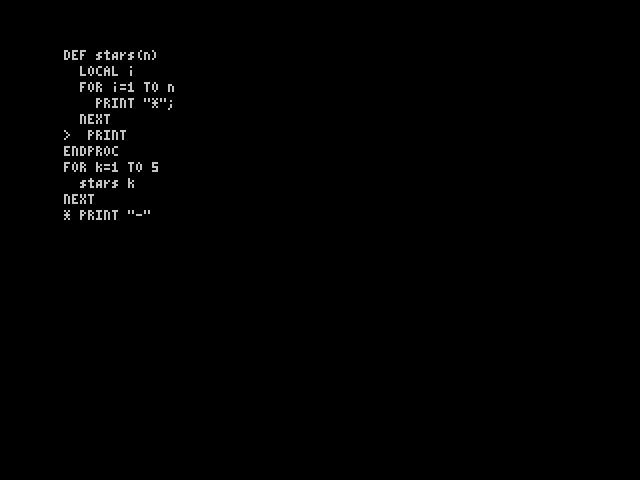

# Phase 4: the line editor

Nathan decided against a full-screen editor. OpticOS follows the ZX BASIC pattern instead: a **current-line marker** that you move up and down over a LIST, and **EDIT** to bring that line into the input line, change it and put it back. Spec v0.4 §6.5–6.6 and decision 7 describe it.

The screenshot was taken in real Fuse (`--no-traps --no-detect-loader --no-accelerate-loader`, via `tools/fuse_phase4.py`). The program was typed with AUTO and listed, then the marker was moved up four lines with CAPS+7 to `PRINT`. EDIT (CAPS+1) brought the line into the input line with the `*` prompt, and ` "-"` was typed onto it. After ENTER and RUN, the edited line is in place and the output changes accordingly: [`fuse_after_edit.png`](fuse_after_edit.png). The earlier step, LIST with the marker on the last line entered, is [`fuse_list_marker.png`](fuse_list_marker.png).

## How it works for the user

| To | Do |
|---|---|
| Type a program | `AUTO`, then type the lines. The prompt is `+`, and each line goes in after the current one and becomes current. An empty line (just ENTER) ends AUTO. |
| See it | `LIST` lists the whole program with `>` in front of the current line. |
| Move the marker | CAPS+7 (up) / CAPS+6 (down) move it one line and relist about ten lines either side of it. Going up from the first line moves it above the program, so AUTO then inserts at the top. |
| Change a line | Move the marker to it, press EDIT (CAPS+1). The line appears after a `*` prompt. Edit it and press ENTER to replace it. |
| Delete a line | EDIT, EDIT (the second press empties the input line), ENTER. The line before it becomes current. |
| Insert a line in the middle | Put the marker on the line above, `AUTO`, type, empty ENTER. |
| Fix an error | An uncaught error makes its line the current line, so EDIT brings it up at once. |
| Edit the input line | CAPS+5 / CAPS+8 move left / right, typing inserts at the cursor, and DELETE (CAPS+0) removes the character to the left. A line can be up to **126 characters** (two screen rows); the old limit was 61. |

Anything typed at the `]` prompt runs at once, as before. The temporary `>` prefix of Phase 3 is gone.

## Size

The editor costs **585 bytes** in total, against a target of under 800:

| Part | Bytes |
|---|---:|
| Marker LIST, auto-list around the marker, cursor up/down, EDIT capture (`edit.asm`, in the gap after the print code) | 268 |
| Input line with a cursor: insert, delete, left/right, two-row redraw, mode prompt (console growth) | 165 |
| Program line insert/delete, entry modes, AUTO (`basic.asm`, token table) | 152 |

EDIT costs almost nothing extra for detokenising. It runs the normal LIST code with the output channel pointed at a two-byte "channel" that appends to the input line. Lines that are skipped before the window go through a null channel, so the indentation is still worked out correctly.

ROM: 14,426 bytes placed, **1,958 free** (the 256-byte margin rule holds). In spec v0.4 the full-screen editor's 1,400-byte budget becomes 600 for this editor. That brings the projected full ROM to 17,113 bytes, so **the overall shortfall drops from about 1,785 to about 985 bytes** once the 256-byte margin is kept. Phase 5 still has to find about 1 KB.

## Tests

| Suite | Result |
|---|---|
| `tools/rig/test_phase4.py` (new, real key presses) | 13/13: AUTO entry, marker, cursor up/down and the ends of the program, EDIT plus insert, EDIT EDIT ENTER delete, insert in the middle and at the top, left/DELETE/right/insert in the input line, a 126-character line, the error line becoming current |
| `tools/rig/test_phase3.py` | 49/49 (programs now go in through AUTO) |
| `tools/rig/test_phase1.py` | 35/35 |
| `tools/rig/test_maths.py --n 3000` | 0 failures, console lines 13/13 |
| zexall | all OK |
| `tools/similarity_check.py` | OK (no shared run of 12 or more bytes) |

## Deviations and choices

- **Insert rule:** lines are inserted only in AUTO mode, which a typed `AUTO` turns on and an empty line turns off. Without line numbers there is nothing Spectrum-like that tells a program line from a direct command. AUTO costs about 10 bytes and is the clearest rule. (BBC users will know the name; here it means "insert after the marker", not numbering.)
- **Delete** is EDIT, EDIT, ENTER rather than a DELETE command. That costs 6 bytes, with no new keyword.
- **The marker** is printed before the line's indentation (`>  PRINT`), so the current line is shifted one column.
- **Entering or changing a line still clears the variables.** Keeping them would mean moving the variable area and the DEF table and fixing every string back-pointer, which is not cheap. NEW, LOAD and RUN behave as before.
- **Cursor up/down discard** anything half-typed in the input line, and their relist clears the screen.
- **The input line moved** from the printer buffer to `$5D50` (128 bytes), and the program now starts at `$5DD0`. The printer buffer at `$5B00` is still scratch space for VAL and the error unwinder.
- The spec v0.2 status bar, page up/down, find, join, clipboard and E-mode editor keys are dropped along with the full-screen editor.
