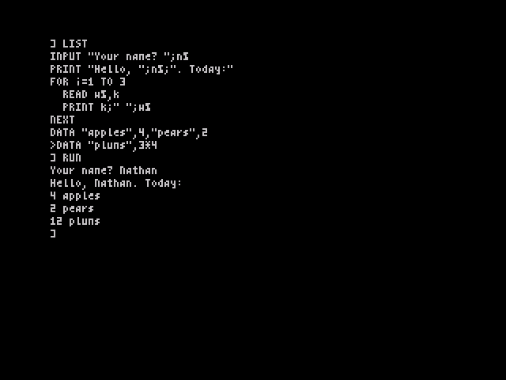
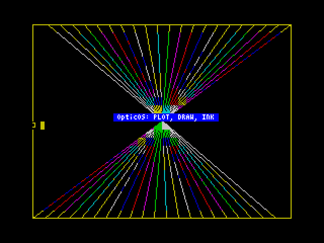

# Phase 5a: size pass and the core I/O statements

Phase 5 is the polish phase, and its overriding goal is to make the full planned feature set fit the 16K ROM with a 256-byte margin. This first milestone does the cheap part of the size pass and adds the most needed statements: `INPUT`, `DATA` / `READ` / `RESTORE`, and the tape commands `SAVE` / `LOAD` / `VERIFY`, including their `CODE` forms.

The screenshot was taken in real Fuse (`--no-traps --no-detect-loader --no-accelerate-loader`, via `tools/fuse_phase5.py`). The program was typed with AUTO, listed and run, and `Nathan` was typed in answer to the INPUT.

## What was added

| Statement | Behaviour |
|---|---|
| `INPUT ["prompt";] v [, v …]` | Prints the prompt, then reads one line per variable at the print position. The line is edited with the usual input-line keys (left, right, DELETE, insert). EDIT and the marker keys do nothing during INPUT. A numeric variable takes the text's value, as `VAL` would. String variables, array elements (`INPUT a(2)`) and direct-mode use all work. |
| `DATA items` | Skipped when run, like `REM`. A DATA statement must start its line. Items are any expressions (`DATA "plums", 3*4`). |
| `READ v [, v …]` | Takes the next DATA item. `Out of DATA` (error 20) is raised when there are none left. |
| `RESTORE` | Starts again from the first DATA line. RUN and any program change also restore. |
| `SAVE "name"` | Saves the program as a standard type-0 ("Program:") header and a data block that starts with the signature `"OB" 1 0` (spec §3.1), then the tokenised lines and the end marker. |
| `SAVE "name" CODE start, length` | A standard type-3 ("Bytes:") file |
| `LOAD "name"` / `LOAD ""` | Finds the program and loads it. An `OB` block is moved into place as an OpticBASIC program, with the variables cleared, and you return to the prompt. Any other type-0 block is a Sinclair BASIC program and goes to the legacy loader, as before. |
| `LOAD "name" CODE [start]` | Bytes, at the header's address or at `start` |
| `VERIFY "name" [CODE [start]]` | Compares the tape with memory. A mismatch gives *Tape: bad or missing block*. |

Names are string expressions, padded to 10 characters, and `""` means "the first one found". Every header seen is printed (`Program: squares`) while searching, as before.

## Size pass

- **ASN and ACS were dropped** (the brief allowed it), along with their keywords: −87 bytes. `ATN(x/SQR(1-x*x))` gives ASN.
- **INPUT and READ share one variable-list loop**, and the tape commands share the name parser and the signature writer. LOAD reuses the legacy loader's header search, which gained a verify flag (+7 bytes). The new code was placed in the gaps after the error messages and after the line editor.
- I did not do the remaining maths items from the phase 2 list (STR$ small-integer path, compare, COS from SIN, EXP terms, VAL, register xorshift; about 290 bytes in total). Each one needs the 3,000-case mpmath run and the RNG statistics checked again. Since the ROM still has room for the next features, they are better done when the space is actually needed.

## Start-up chime

As Nathan asked, the cold start now plays the BBC Micro's two power-on tones with the same pitches and durations, in reverse order. The BBC's tones are first the uninitialised SN76489, about 122 Hz for about 0.9 s, then the default BELL (pitch 101, duration 6), which is 523.25 Hz for 0.3 s. OpticOS plays 523.25 Hz for 0.3 s, a 40 ms gap, then 122.2 Hz for 0.9 s, using two BEEPER calls after the boot screen is drawn. That is 23 bytes, with no data table: the values are immediate operands. The rig measures 523.3 Hz / 0.30 s and 121.9 Hz / 0.90 s. Sources and figures are in spec §6.7. The chime makes the cold start about 1.25 s longer, so the rigs now wait 150 frames, not 80, before typing. The SA-BYTES timing test now finds the sync pulse rather than counting to a fixed index, because the chime leaves the speaker bit in the other state, which adds one edge. Bounce Ball and Mire Mare still load.

## Bytes

| | Bytes |
|---|---:|
| INPUT, DATA / READ / RESTORE (`input.asm`) | 182 |
| INPUT hooks in the console (read a line and return; editor keys off) | 30 |
| SAVE / LOAD / VERIFY / CODE (`tape.asm`) and the loader changes | 296 |
| New keywords (INPUT DATA READ RESTORE SAVE VERIFY CODE) minus ASN/ACS | 36 |
| Error message *Out of DATA*, RESTORE on RUN, workspace reset on LOAD | 29 |
| ASN / ACS code removed | −77 |
| Old LOAD "" handler removed | −17 |
| **Net** | **+473** |

ROM: **14,899 bytes placed, 1,485 free** (was 14,426 / 1,958).

## Budget: what still has to fit

The spec's budget (§8.2, v0.6) now counts the keyword table for the roughly 45 keywords still to come (about 270 bytes), which the v0.4 projection missed. With that included, the full feature list needs **17,306 bytes**. That is 922 over 16 KB, or **about 1,180 bytes over once the 256-byte margin is kept**. About 1,230 bytes are usable for the remaining features, against about 2,400 bytes of budget.

Proposed ways to close the gap, for Nathan to choose from:

| Option | Saves (approx.) |
|---|---:|
| Remaining maths squeeze (six items above) | 290 |
| Shared argument parsing and RST helpers in the evaluator and statements | 300 |
| Drop `SCREEN$(r,c)`, `ATTR`, `POINT` | 120 |
| Drop `CIRCLE` | 90 |
| Drop `MODE 32` and UDG printing (keep 64 columns only) | 170 |
| Drop `SOUND` (keep `BEEP`) | 40 |
| Drop `FIND`, `CONT`, `ERRLINE`, `ERRPROC$` | 150 |
| Drop `LABEL` / `GOTO` | 100 |
| Trim the legacy loader shim | 150 |

My recommendation: do both squeezes (about 590), drop SCREEN$/ATTR/POINT, FIND/CONT/ERRLINE/ERRPROC$ and SOUND (about 310), and decide on MODE 32 versus CIRCLE and LABEL/GOTO for the rest.

## Tests

| Suite | Result |
|---|---|
| `tools/rig/test_phase5.py` (new) | 20/20: INPUT (echo, prompt, number, string, array element, direct mode), DATA/READ (numbers, strings, expressions, across lines), RESTORE, RUN restores, *Out of DATA*. SAVE recorded from MIC and decoded (header, `OB` signature), LOAD "name" and LOAD "" back through EAR (program lists and runs), VERIFY pass and fail, SAVE CODE / LOAD CODE start / VERIFY CODE. |
| `tools/rig/test_phase4.py` | 13/13 |
| `tools/rig/test_phase3.py` | 49/49 |
| `tools/rig/test_phase1.py` | 35/35, including real game tapes through `LOAD ""` |
| `tools/rig/test_maths.py --n 3000` | 0 failures (ASN/ACS cases removed) |
| zexall | all OK |
| `tools/similarity_check.py` | OK |

`tools/rig/p3lib.py` now leaves the key-wait routine properly when it injects a line, as a real ENTER does. INPUT depends on that.

## Not done yet

In spec priority order: graphics (`PLOT`, `DRAW`, `CIRCLE`), `BEEP` / `SOUND`, `INSTR`, `STRING$`, `HEX$`, `UPPER$`, `ERR$`, `CASE`, `EXIT`, `SWAP`, `MODE 32` / UDGs from BASIC, the colour statements inside PRINT, and the machine statements (`CALL`, `USR`, `OUT`, `IN`, `DPEEK` / `DPOKE`, `KEY`, `JOY`). `SAVE … AUTO`, `SCREEN$` tape forms and `CAT` are also still to do.

---

# Phase 5b: Nathan's cuts, the squeezes, graphics and functions

Real Fuse again (`tools/fuse_phase5.py`). The program fans out lines with `DRAW TO`, cycling `INK`, draws a border with relative `DRAW`, prints a caption with `PRINT AT 11,20; INK 7; PAPER 1; BRIGHT 1;…`, and plays three notes with `BEEP`. Colour clash in the 8×8 attribute cells is as on any Spectrum.

## Decisions recorded (spec §12, items 8–12)

- Dropped: `MODE 32` and UDG printing, `CIRCLE`, `LABEL` / `GOTO` (no `GOSUB`; PROCs replace it), `SCREEN$(r,c)`, `ATTR`, `POINT`, `FIND`, `CONT`, `ERRLINE`, `ERRPROC$`, `SOUND`.
- Labels become PROC names: `RUN name`, `RESTORE name` (the first DATA after that DEF) and `SAVE "x" AUTO name`. These are specified but **not built yet**.
- The legacy shim is kept whole. It already prints at 64 columns and doubles the `PRINT AT` column, so it needed no 32-column path. Bounce Ball and Mire Mare still load (phase 1 tests, 35/35).

## Squeezes

| Squeeze | Saved |
|---|---:|
| GET-CHAR (`tk`), NEXT-CHAR (`skip1`) and "expression → integer" moved into the unused restarts `$18`, `$20`, `$30`; about 80 three-byte `CALL`s became one-byte `RST`s (also faster) | 186 |
| RND: the same xorshift (13, 17, 5) with its state in registers instead of a memory buffer (identical numbers) | 21 |
| A shared "number 0–255" entry, `ev_u8` | 15 |
| **Total** | **222** |

Tried and rejected: sending small integers through the float path in STR$ would save 36 bytes, but printing an integer becomes about 15 times slower (about 80,000 T-states, 23 ms per number). I judged that a bad trade against the integer speed goal and reverted it. The other maths items (COS from SIN, fewer EXP terms, a smaller VAL digit loop; about 130 bytes) are not done yet. Each needs the full mpmath run. The compare routine turned out to be compact already, so the estimated 70 bytes from it are not there.

## What was added

| | |
|---|---|
| `PLOT x,y` | 256×192, origin bottom left (y 0–191). `OVER 1` flips the pixel, `INVERSE 1` clears it, and the 8×8 cell takes the current colours. |
| `DRAW dx,dy` / `DRAW TO x,y` | Lines from the last point (COORDS), stepping along the longer axis. Going off the screen is *Value outside range*. |
| `FLASH`, `BRIGHT`, `INVERSE`, `OVER` | New statements, alongside `INK` and `PAPER` |
| Colours inside PRINT | `PRINT INK 2; PAPER 6; "x"`. INK, PAPER, FLASH and BRIGHT last until the statement ends. INVERSE and OVER inside PRINT stay set, because the print routine has only permanent bits for them. |
| `BEEP duration, pitch` | Sinclair semantics: pitch in semitones from middle C, f = 261.63·2^(p/12), through BEEPER. Middle C measures 261–262 Hz in the rig, and the octave 523 Hz. Pitch is limited to about −24…69 (the period must fit 16 bits). |
| `INSTR(a$, b$ [, start])` | Position or 0. `""` is found at the start position. |
| `STRING$(n, s$)`, `HEX$(n)` (4 digits), `UPPER$(s$)`, `ERR$` | `ERR$` is the last error's message, or `""` if there was none. |
| `IN(port)`, `OUT port, b`, `USR(addr)` (returns BC), `CALL addr`, `DPEEK(addr)`, `DPOKE addr, w`, `JOY` (Kempston port 31) | |
| `SWAP a, b` | Numbers, integers, strings or array elements of the same type. Swapping strings re-points each heap block at its new owner. |

**Clean-room note.** The first 5b commit (5fc484a) failed the 12-byte similarity check, and I pushed it before noticing. The six new colour keywords sat in the keyword table in the same order as in the Sinclair ROM's token table (INK PAPER FLASH BRIGHT INVERSE OVER), so their spellings formed matching 12-byte runs. The follow-up commit reverses their token order (OVER … INK, with PRINT mapping them to control codes 21 − index), and the check passes again. No code was copied; the match was keyword names in a shared order.

## Bytes

ROM: **15,693 placed, 691 free** (14,899 / 1,485 after 5a). The new code is 238 (graphics) + 196 (BEEP, OUT, DPOKE, CALL, SWAP) + 386 (functions) + 50 (PRINT colours, colour statements, the console's colour reset) + 129 (keywords and dispatch entries), less the 222 bytes saved, plus 23 for the start-up chime. The dispatch tables moved out of the full gap J2 into the last section.

## Budget (spec §8.2, v0.7)

With the cuts, the remaining features (CASE, EXIT, `ERROR n, msg$`, CLEAR, RUN/RESTORE/SAVE AUTO with a PROC name, SCREEN$ tape forms, CAT, KEY, FREE, array parameters, CALL register arguments) are budgeted at about 730 bytes. The finished ROM would then be 16,425 bytes, **about 297 bytes over once the 256-byte margin is kept**. In v0.6 that figure was about 1,180. My proposal to close it: drop array parameters by reference (80), CALL register arguments (30), CAT (45) and the SCREEN$ tape forms (25), and do the remaining maths squeezes (about 130).

## Tests

| Suite | Result |
|---|---|
| `tools/rig/test_phase5.py` | 42/42 (22 new): PLOT at the corners and in range, DRAW and DRAW TO paths and end points, COORDS, OVER and INVERSE, range errors, colours inside PRINT ending with the statement, BRIGHT/FLASH, BEEP frequency and length measured from the speaker signal, INSTR (6 cases), STRING$, HEX$, UPPER$, ERR$ in a CATCH, DPOKE/DPEEK, USR and CALL on poked code, IN/JOY, SWAP of numbers and strings (then the string is changed), SWAP type mismatch |
| Phase 1, 3, 4 | 35/35, 49/49, 13/13 |
| `test_maths.py --n 3000` | 0 failures; RND 3,000 values, mean 0.4954, chi-square 11.25 (9 dof), repeatable |
| zexall, similarity check | OK |

## Not done yet

CASE / WHEN / OTHERWISE, EXIT, `ERROR n, msg$`, CLEAR, `RUN name`, `RESTORE name`, `SAVE … AUTO name`, `SCREEN$` tape forms, CAT, `KEY(k$)`, FREE, array parameters, CALL register arguments.

# Phase 5c: the last features

Nathan's decision for phase 5c (spec §12, decision 13): drop array parameters by reference, `CALL` register arguments, `CAT` and the OpticBASIC `SCREEN$` tape forms (legacy loaders keep `LOAD "" SCREEN$`), and drop `JOY` (use `IN 31`). `BORDER` stays. Then do the remaining maths squeezes and build the rest. The feature list is now complete, and the ROM keeps the 256-byte margin.

## What was added

| Feature | As built |
|---|---|
| `CASE expr OF` / `WHEN v [, v …]` / `OTHERWISE` / `ENDCASE` | Numbers or strings. The first matching WHEN runs, otherwise OTHERWISE. The prepass links CASE → WHEN → … → ENDCASE through the IF/ELSEIF/ENDIF logic, by mapping the four tokens onto it. At run time a WHEN or OTHERWISE reached at the end of a branch jumps to ENDCASE through the links. The selector stays on the value stack only while the values are compared. LIST indents the branches. |
| `EXIT WHILE` / `EXIT REPEAT` / `EXIT FOR` | Continues after the matching WEND, UNTIL or NEXT statement. It finds that statement by counting the loop keywords forwards (each closing token is its opening token + 1), so it also works for one-line loops. EXIT FOR drops the FOR frame. |
| `ERROR n [, msg$]` | ERR = n. msg$ (up to 28 characters) is kept in `EMBUF` and becomes ERR$ and the error report (`msg$, line L`). A ROM error or a plain `ERROR n` clears it. |
| `CLEAR [n]` | Forgets the variables, open loops and PROC calls. `CLEAR n` moves RAMTOP, so the stacks, the direct line and the heap move with it. It needs n − 1,856 above the variables ("No room" otherwise). In a program, execution carries on; typed directly, the rest of the line is not run. |
| `FREE` | A function: the bytes between the variables and the string heap. |
| `KEY(k$)` | TRUE while the key for the first character is held (letters, digits, space). It reads the keyboard matrix directly, so `KEY("q") AND KEY("p")` works. |
| `RUN name` | The prepass, then a call of that PROC (without parameters). At its end OpticOS returns to the prompt. |
| `RESTORE name` | READ continues from the first DATA line after that PROC's DEF. |
| `SAVE "x" AUTO name` | Header parameter 1 holds the DEF line's offset in the program (`$8000` = no auto-start). After LOAD, OpticOS runs `RUN name`. |

## Squeezes and bytes

| Change | Bytes |
|---|---:|
| Maths squeezes: COS from SIN (cos r = 2(½ − sin²(r/2)), one polynomial fewer), EXP with 8 coefficients (was 9), a shorter VAL digit loop | −39 |
| **RST `$28` enters the maths byte-code** (every `call fu_run` becomes `rst $28`), and the "Calculator not supported" message goes | −99 |
| New modules (measured): CASE 81, EXIT 68, ERROR n, msg$ 64, PROC-name lookup 24, CLEAR 62, KEY 63, FREE 14 | +376 |
| Everything else, net: ten new keywords and their dispatch, the hooks in ERR$, the error report, RESTORE, SAVE/LOAD, RUN, the prepass and LIST, the shared `cmp2` compare, less `JOY` | +168 |
| Fix: line numbers in error reports | +2 |

ROM: **16,101 placed, 283 free** (was 15,693 / 691). The new code is in seven pieces packed into the gaps (`case.asm`, `clear.asm` in J2; `flow.asm`, `error2.asm`, `misc2.asm` in K; `keyfn.asm` in I). POKE, WAIT and RANDOMIZE moved out of `basic.asm` to make room.

**Accuracy cost of the maths squeezes** (`test_maths.py --n 3000`, 0 failures in both runs):

| | Before (phase 2 figures) | After (5c) |
|---|---:|---:|
| SIN max ulp | 1.07 | 1.81 |
| COS max ulp | 1.08 | 1.57 |
| TAN max ulp | 2.71 | 3.27 |
| EXP max ulp | 0.78 | 0.94 |
| VAL max ulp | 1.97 | 2.05 |
| RND (3,000 values) | mean 0.4954, χ² 11.25 | mean 0.4954, χ² 11.25, repeatable |

The maths squeezes came to 39 bytes, not the 130 estimated: the VAL loop and the EXP terms gave less than hoped. The RST `$28` change made up the difference.

## Deviations and things to confirm

- **RST `$28` (spec decision 14, to confirm).** Decision 5 had RST `$28` raise "Calculator not supported". It now enters OpticOS's maths byte-code. Sinclair calculator code fails on OpticOS either way, but now without the message. Undoing this costs about 99 bytes, which would leave about 185 free, below the margin, and then something else would have to go (for example `ERROR n, msg$`, about 64 bytes plus its hooks, or `CLEAR n`).
- **Program start moved** from `$5DD0` to `$5DF0`. The 32 bytes below it hold the ERROR message (28) and the tape signature (4). Programs saved by earlier builds still load, because the loader works from the header length, but token values changed with the new keywords, so older saved programs list wrongly.
- `FREE` is a function (`PRINT FREE`), not a command. `RUN name` and `SAVE … AUTO name` take a PROC with no parameters. EXIT FOR should not be used from inside a TRY within the loop.
- An unclosed CASE is reported at its last WHEN line, as an unclosed IF is at its last ELSEIF.
- **Bug fixed:** error reports gave "line 2" for any error after line 2: the line counter called `nxl`, which changes DE. Earlier tests never raised an error below line 2.

## Tests

| Suite | Result |
|---|---|
| `tools/rig/test_phase5.py` | 72/72 (30 new): CASE with lists, expressions, OTHERWISE, no match, strings, nesting, type mismatch, missing ENDCASE, LIST indent; EXIT WHILE, EXIT REPEAT (nested), EXIT FOR (one-line loop, then the rest of the NEXT line); ERROR n, ERROR n, msg$ (report, ERR/ERR$ in CATCH, cleared by a ROM error and by a plain ERROR n, 28-character limit); error line numbers past line 2; FREE; CLEAR, CLEAR n (RAMTOP, FREE, too low, in a program); KEY (held, not held, two at once, space, digit, empty); RUN name, unknown name; RESTORE name; SAVE AUTO (header offset, loads and runs, program intact); **BORDER in OpticBASIC and in the legacy shim** (a generated `10 BORDER 2` Sinclair tape) |
| Phase 1 (with the reference ROM), 3, 4 | 35/35 (Bounce Ball and Mire Mare load through `LOAD ""`), 49/49 (the old RST `$28` test now checks the byte-code entry), 13/13 |
| `test_maths.py --n 3000` | 0 failures (figures above) |
| zexall, layout, 12-byte similarity check | OK |

## Before a v1.0

- A user manual: OpticBASIC reference, editor keys, tape, and the differences from Sinclair BASIC.
- An example tape: a few OpticBASIC programs (game, graphics, CASE/TRY demo) saved with `SAVE … AUTO`.
- A check on a real 48K Spectrum and a real TV: tape loading from audio, timing, the 64-column font's legibility on a CRT, and the start-up chime.
- Nathan to confirm decision 14 (RST `$28`).
