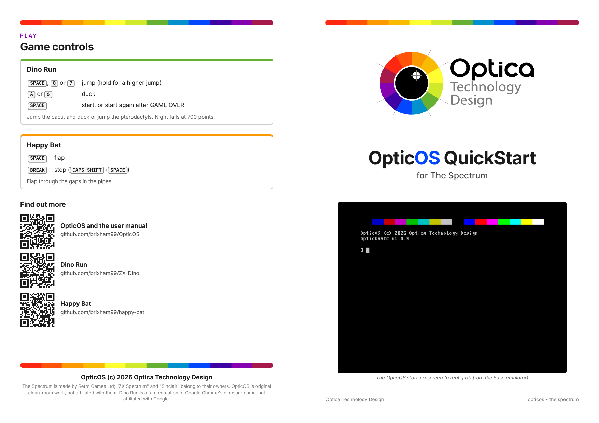
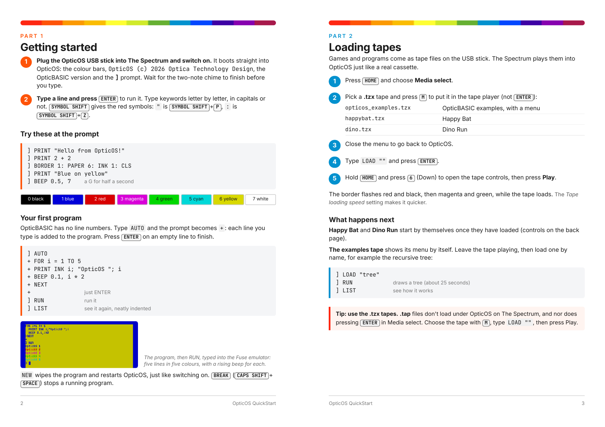

# OpticOS QuickStart for The Spectrum

There is a second booklet in the same format for the Fuse emulator on a Mac: [fuse-mac/](fuse-mac).

This is a four-page A5 booklet to go in the box with an OpticOS USB stick for The Spectrum (Retro Games, 2024). It prints on one A4 sheet, double-sided, and folds in half.

| Page | Contents |
|---|---|
| 1 (cover) | The Optica logo, the title, and a Fuse grab of the OpticOS start-up screen |
| 2 | Part 1, Getting started: switching on, typing at the `]` prompt, a few commands to try (`PRINT`, `BORDER`/`PAPER`/`INK`, `BEEP`), a first program with `AUTO`, `RUN`, `LIST`, `NEW` and BREAK |
| 3 | Part 2, Loading tapes: Media select, choosing a `.tzx` and pressing **M**, `LOAD ""`, HOME + Down for the tape controls, and the `.tzx` not `.tap` tip |
| 4 (back) | The Dino Run and Happy Bat controls, QR codes for OpticOS, ZX-Dino and Happy Bat, and the copyright line |

## Printing

1. Print `OpticOS_QuickStart_A4_imposed.pdf` on A4, at **actual size** (100 %, not "fit to page").
2. Choose double-sided, **flip on short edge**. Side 1 has page 4 on the left and the cover on the right. Side 2 has pages 2 and 3.
3. Fold the sheet in half with the cover on the outside.

All text stays at least 10 mm from the paper edges and from the fold (13 mm on the fold side of each page), well inside the 5 mm safe area; `build.py` checks this in each PDF.

## Files

| File | What it is |
|---|---|
| `OpticOS_QuickStart_A4_imposed.pdf` | 2 pages, A4 landscape: the print file |
| `OpticOS_QuickStart_A5_reader.pdf` | 4 pages, A5 portrait, in reading order, for the screen |
| `OpticOS_QuickStart_side1.png`, `_side2.png` | 150 dpi previews of the two A4 sides |
| `quickstart.html`, `build.py` | The source and the build. `python3 build.py` needs google-chrome, poppler-utils and segno |
| `fuse_quickstart.py` | Boots `build/opticos.rom` in Fuse, types every snippet from page 2 and saves the grabs in `img/` |
| `img/` | The Fuse grabs: `boot.png` (cover), `prog_run.png` and its crop `prog_run_top.png` (page 2), `prog_list.png`, `try_colour.png` |
| `optica_logo.svg` | The Optica logo (`build.py` writes a cropped copy, `optica_logo_crop.svg`) |

The text uses Inter, and the code uses JetBrains Mono (both from `docs/manual/fonts`). The colours are the logo's twelve hues.

Every command and the program on page 2 were typed into OpticOS in Fuse by `fuse_quickstart.py`, and the grabs show the results. OpticBASIC has no line numbers, so the first program is entered with `AUTO`. The loading steps follow the manual, chapter 8, "Loading on The Spectrum (2024)". The tape names are those in the repositories: `opticos_examples.tzx`, `happybat.tzx` and `dino.tzx` (from [ZX-Dino](https://github.com/brixham99/ZX-Dino)).
