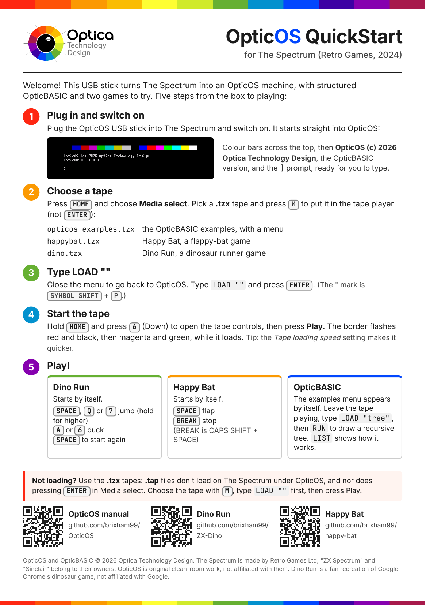

# OpticOS QuickStart for The Spectrum

This is a one-page A5 portrait sheet to go in the box with an OpticOS USB stick for The Spectrum (Retro Games, 2024). It covers switching on, choosing a `.tzx` tape in Media select, `LOAD ""`, the tape controls, and the game controls, with a troubleshooting line and QR codes for OpticOS, Dino Run and Happy Bat.

| File | What it is |
|---|---|
| `OpticOS_QuickStart_A5_trim.pdf` | 148 × 210 mm: the trimmed page, for home printing |
| `OpticOS_QuickStart_A5_bleed.pdf` | 154 × 216 mm: 3 mm bleed all round (the colour bands run into it), for a print shop |
| `OpticOS_QuickStart_A5.png` | A 200 dpi preview of the trim version |
| `quickstart.html`, `build.py` | The source and the build. `python3 build.py` needs google-chrome, poppler-utils and segno |
| `optica_logo.svg`, `boot_top.png` | The Optica logo (`build.py` writes a cropped copy, `optica_logo_crop.svg`), and the top of the manual's Fuse grab of the start-up screen |

The text uses Inter, and the code uses JetBrains Mono (both from `docs/manual/fonts`). The colours are the logo's twelve hues. All text stays at least 5 mm inside the trim: it sits 8 mm in, and `build.py` checks this in each PDF.

The steps follow the manual, chapter 8, "Loading on The Spectrum (2024)". The tape names are those in the repositories: `opticos_examples.tzx`, `happybat.tzx` and `dino.tzx` (from [ZX-Dino](https://github.com/brixham99/ZX-Dino)).
