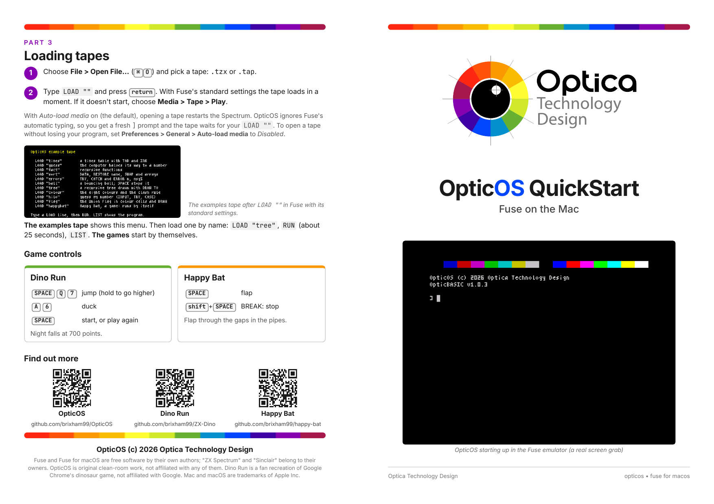
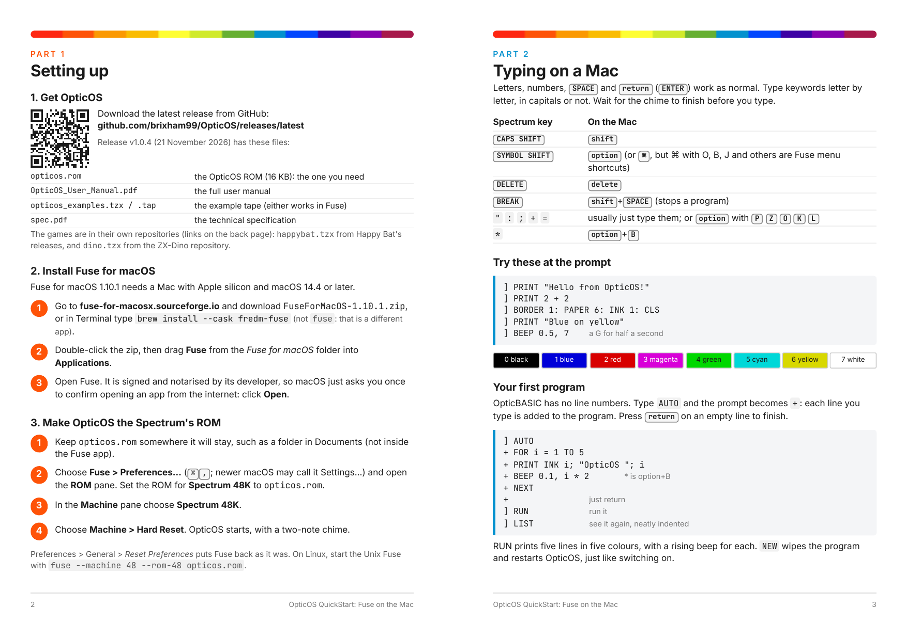

# OpticOS QuickStart: Fuse on the Mac

A four-page A5 booklet for running OpticOS in [Fuse for macOS](https://fuse-for-macosx.sourceforge.io/). It uses the same format as the [QuickStart for The Spectrum](..): one A4 sheet, printed double-sided and folded in half.

| Page | Contents |
|---|---|
| 1 (cover) | The Optica logo, the title, and a Fuse grab of the OpticOS start-up screen |
| 2 | Part 1, Setting up: the latest release on GitHub (with a QR code) and its files, installing Fuse for macOS, and making `opticos.rom` the Spectrum 48K ROM |
| 3 | Part 2, Typing on a Mac: the Mac keys for CAPS SHIFT, SYMBOL SHIFT, DELETE, BREAK and the symbols, commands to try, and a first program with `AUTO` |
| 4 (back) | Part 3, Loading tapes (File > Open File…, `LOAD ""`, auto-load), the game controls, QR codes and the copyright line |

## Printing

Print `OpticOS_QuickStart_FuseMac_A4_imposed.pdf` on A4 at actual size, double-sided, **flip on short edge**. Fold it in half with the cover outside. All text stays at least 10 mm from the paper edges and the fold; `build.py` checks this.

## Files

| File | What it is |
|---|---|
| `OpticOS_QuickStart_FuseMac_A4_imposed.pdf` | 2 pages, A4 landscape: the print file (side 1 = p4 \| p1, side 2 = p2 \| p3) |
| `OpticOS_QuickStart_FuseMac_A5_reader.pdf` | 4 pages, A5, in reading order |
| `OpticOS_QuickStart_FuseMac_side1.png`, `_side2.png` | 150 dpi previews of the two sides |
| `quickstart_fuse_mac.html`, `build.py` | The source and the build (`python3 build.py`; needs google-chrome, poppler-utils and segno). The logo, fonts and the cover grab come from `..` and `docs/manual/fonts` |
| `fuse_mac_test.py` | Runs the page 4 tape steps in real Fuse with Fuse's standard tape settings, auto-load on and off, and saves the grabs in `img/` |

## Where the facts come from

- **The release:** `gh release view` on v1.0.4 (the latest, 21 November 2026): `opticos.rom`, `OpticOS_User_Manual.pdf`, `spec.pdf`, `opticos_examples.tzx` and `opticos_examples.tap`. Happy Bat's v1.0 release has `happybat.tzx` and `.tap`; ZX-Dino has `dino.tzx` and `.tap` in the repository.
- **Fuse for macOS 1.10.1** (checked 20 November 2026): the download from SourceForge and the Homebrew cask `fredm-fuse` (the cask called `fuse` is an unrelated app, Fuse Studio). The app is arm64 only, needs macOS 14.4 or later (`LSMinimumSystemVersion`), and is signed with a Developer ID with a stapled notarisation ticket. The project's news says releases after 1.5.6 are Apple silicon only.
- **Menus, panes and keys:** the app's own help (Menus And Keys, ROM, Machine and General Preferences, Key Mappings) and its menu file. Preferences… is ⌘, and Open File… is ⌘O. Shift is CAPS SHIFT; Command and Option are both SYMBOL SHIFT; Delete is DELETE. Punctuation keys including `"` `:` `;` `+` `=` are mapped to the symbol-shifted keys, but `*` is not in the list, so the booklet gives Option+B.
- **Tape loading:** `fuse_mac_test.py` ran on the Unix Fuse 1.6.0, which shares its emulation core with Fuse for macOS, with tape traps, loader detection and acceleration, and fast loading on. With auto-load on, the examples `.tzx` and `.tap` open at a clean `]` prompt (OpticOS drops the typist's keys, spec §6.7) and `LOAD ""` then loads the menu. With auto-load off, `dino.tzx` and `happybat.tap` load and start. These tests were not run on a Mac.
- The typing snippets are the ones `../fuse_quickstart.py` typed into Fuse for the first booklet.
